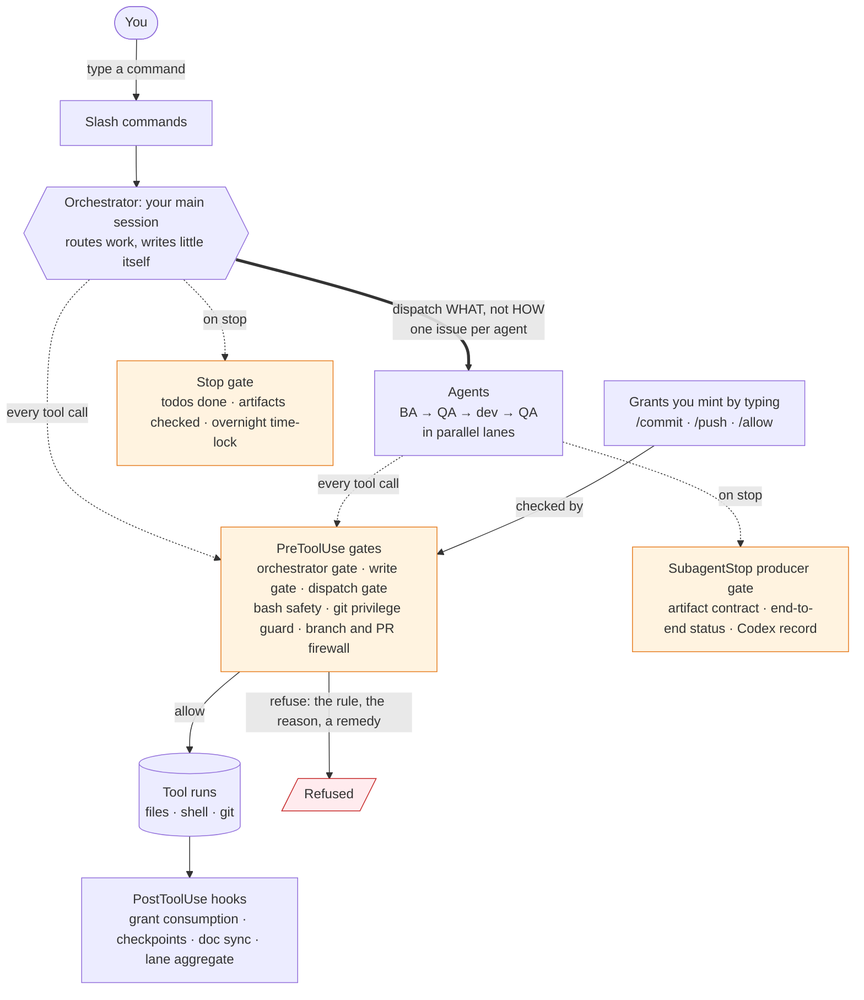
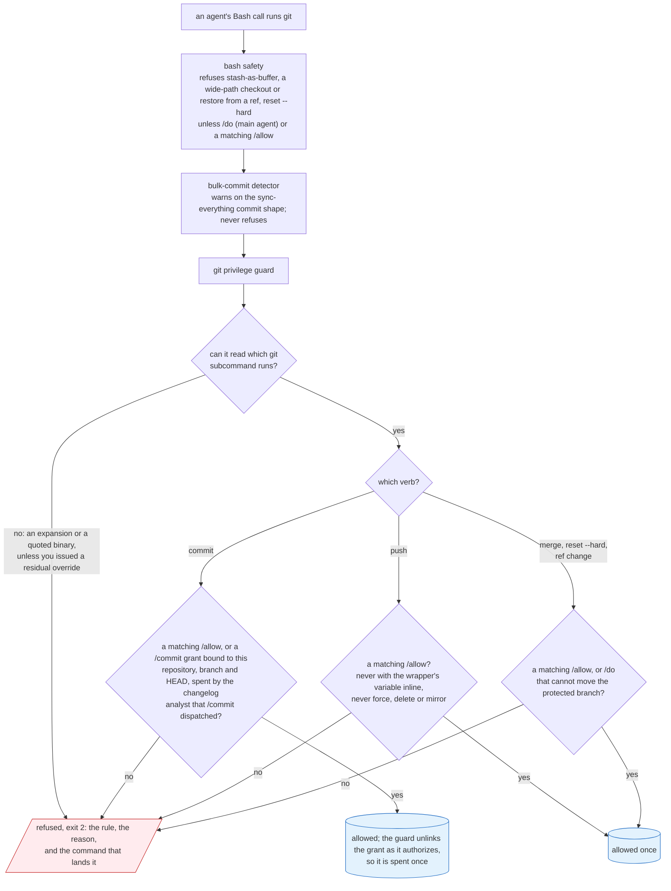
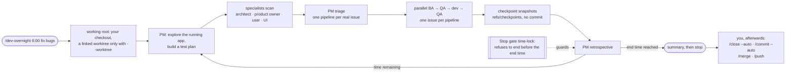

# awesome-claude-harness

An unattended development harness for Claude Code. Give it a requirement and go to work: it finds the root cause, asks you only the decisions that are yours, then builds and verifies; the commands you type to land the work, `/close`, `/commit` and `/push`, have agents review, commit and push it, with no human review in the loop. Prompts guide the agents; hooks refuse what prompts can only ask for.

**What is proven and what is not** is on the [status page](docs/status.md): the measured proof, the claim rows and the known limits, every figure generated from the repository and re-checked in CI.

<p>

</p>

## At a glance

- **What it is.** A configuration for Claude Code that you clone into `~/.claude`: hooks, slash commands and agent prompts. Nothing to import into your project.
- **How it differs.** Many agent setups ask the model to behave and trust a human reviewer to catch the rest. Here the main session only routes work; one-issue agents analyse, build and verify it; and hooks, scripts Claude Code runs around every tool call, refuse what a prompt can only ask for: a push without your grant (a one-time permission that a command you type writes), a session that ends with work unfinished, an agent writing outside its job.
- **How to try it.** Clone, run the init, watch a guard refuse a push in a sandbox, then type `/dev <requirement>` in Claude Code. See [Install](#install).

## Feature highlights

| Capability | What it gives you | Grounded in |
|---|---|---|
| **Orchestrator-only architecture** | The main session routes; each real piece of work goes to a fresh agent with one job and a clean context, so quality does not decay as the conversation grows. | `hooks/pretool-orchestrator-gate.py`, `CLAUDE.md` |
| **Your words are the spec** | Your prompt is written to `docs/dev/user-requirement-<id>.md` before any agent runs; every agent reads it, so none works from a reformulation. | `hooks/prompt-workflow.py` |
| **You are asked first** | Before any analysis is built on, `/spec`, `/dev`, `/redev` and `/dev-command` ask you about intent, scope, edge cases and acceptance in Claude Code's question dialog. Without a spec, a panel of independent BAs works from separate angles and QA checks their evidence first; with a spec, one BA asks what it left open. Rounds have no cap; a skipped question settles to its stated default. | `commands/dev.md` (the requirement round), `hooks/lib/requirement_round.py` |
| **Evidence-gated BA → QA → dev → QA** | BA, the business-analyst agent, must cite evidence for the root cause; QA checks the analysis before any code exists and the implementation after it. Each loop ends on its own only when QA passes. | `commands/dev.md`, `agents/ba.md`, `agents/qa.md` |
| **Parallel lanes, never phases** | Several requested outcomes become lanes, one agent pipeline per outcome, that run in parallel inside one cycle. No plan may split an outcome into phases or defer part of it; QA fails one that does. | `commands/dev.md` ("One cycle, no phases") |
| **Declared obligations** | Every dispatch declares its obligation: the artifacts (reports, analyses, test manifests) its agent owes. Each is checked against its schema at that agent's own stop, while its context still exists. | `hooks/pretool-obligation-gate.py`, `hooks/subagentstop-artifact-contract-enforce.py` |
| **A Stop gate that holds** | `/dev`, `/close`, `/commit` and the other gated commands cannot end until code confirms their todo list and artifacts; your `/stop` is the exit. | `hooks/stop-launch.py`, `hooks/stop-command-gate.py` |
| **Release-readiness gate** | `/close` finishes an unfinished cycle, has inspectors and QA judge the diff, ends on `CLOSE: YES` or the findings, and asks you to rate the work. | `commands/close.md`, `hooks/posttool-close-rating.py` |
| **One Codex review loop** | With `--codex`, an OpenAI Codex review runs one complete pass, then only capped re-reviews that verify the fixes. Claude classifies every finding and may reject it; Codex never sets the verdict. | `templates/prompt-includes/codex-consultation.md`, `commands/codex.md` |
| **Git protection kernel** | Agent `commit`, `push`, `merge` and `reset --hard` are refused unless something you typed allows them: `/commit`, `/push` or `/allow`. `/do` never covers a commit or a push; for the main agent, for one turn, it releases a merge, a hard reset or a ref change that cannot move the protected branch. Stash-as-buffer and wide-path checkouts are refused by shape. | `hooks/pretool-git-privilege-guard.py`, `hooks/pretool-bash-safety.sh` |
| **Grants you mint by typing** | `/commit` writes a single-use, time-boxed grant bound to repository, branch and HEAD; `/push` needs a token from `/commit`; `/allow` lets one refused operation through once. | `scripts/write-commit-grant.py`, `hooks/push.sh`, `hooks/lib/allowlist.py` |
| **Branch, PR and worktree firewall** | An agent creating a branch, pull request or worktree is refused, except inside a live `/dev-overnight`, under `/do` for the main agent, or with an `/allow` grant for that command. A `--worktree` overnight run creates its worktree under the first exception; `/merge` creates no branch, it merges inside its own wrapper. | `hooks/pretool-block-branch-pr-worktree.py`, `hooks/pretool-block-enterworktree.sh` |
| **Autonomous overnight runs** | `/dev-overnight 6:00` explores, triages and fixes until a wall-clock end time and commits nothing; the Stop gate's time-lock refuses an early end. You land the work afterwards. | `commands/dev-overnight.md`, `hooks/stop-command-gate.py` |
| **Lossless quota recovery** | `/restart` resumes each interrupted agent by its original id; replacement agents are forbidden. | `commands/restart.md`, `hooks/lib/subagent_restart.py` |
| **Crash-proof checkpoints** | Automatic snapshots go to `refs/checkpoints/<branch>` through git plumbing; your branch HEAD never moves, so `git blame` points at real commits. | `hooks/lib/checkpoint-core.sh`, `docs/reference/checkpoint-mechanism.md` |
| **Scores from facts, and your rating** | A hook reads what each dispatch actually did and writes score events, for example a lane passing QA at the first round, a failure QA pins on BA or dev, a finding close QA opens after lane QA passed, a re-dispatch after a declared artifact went unwritten, a BA panel's refuted root cause or the option you picked. No agent reports its own score. Your `/close` rating counts toward every role that worked on the cycle and the orchestrator, and `/rating` shows each agent's score, rank and trend for the project. | `hooks/lib/score_events.py`, `hooks/lib/score_log.py`, `commands/rating.md` |
| **Generated claims** | Every figure about the repository, on this page and the status page, is computed from the repository; CI fails when one drifts or a number is typed by hand. | `scripts/generate-hero-status.py`, `scripts/readme_facts.py`, `scripts/verify-claims.sh` |
| **UI-audit skills** | Browser-driven review: accessibility injection, contrast, an anti-pattern catalog, a state matrix, token conformance and a weighted beauty score. | `skills/` |

## Why this exists

Autonomous coding agents hurt in places the field has already documented. Each point names its source, then what this repository does about it.

- **The field keeps a person in the loop.** Practitioner guides keep human review before merge ([Augment Code](https://www.augmentcode.com/guides/autonomous-engineering-loop), [Kilo](https://kilo.ai/articles/beyond-autocomplete)). In a study of 37,623 agent-authored pull requests, Claude Code's waited a median of 12.6 hours for a first human review ([arXiv](https://arxiv.org/pdf/2609.17598)). *Here:* you are asked first, about what to build, and after that only for a decision the request, the code and sensible defaults cannot settle; the gate before landing is automated verification, the case [one paper](https://arxiv.org/abs/2606.13175v1) argues for.
- **Autonomy depends on a person building the test oracle.** The parallel-Claude C compiler rested on test suites and verifiers a human wrote ([Anthropic](https://anthropic.com/engineering/building-c-compiler)). *Here:* the oracle lives in `tests/` and runs in CI on every pull request: replays drive each pipeline through the real hooks, fault replays inject failures, and the artifact check demands one producer and a reader for every artifact.
- **Instructions are not enforcement.** Hooks are the deterministic layer ([Claude Code docs](https://code.claude.com/docs/en/best-practices)); `CLAUDE.md` is context, not enforced configuration ([Towards AI](https://towardsai.com/p/machine-learning/claude-code-skills-vs-subagents-vs-hooks-vs-workflows-which-to-use-in-2026)). *Here:* what must hold is a hook, and [the ledger](docs/ENFORCEMENT-LEDGER.md) says how far each hook is proven.
- **Claims outrun the code.** Critics of Cursor's agent-built browser found commits that do not compile and failing CI on main ([The Register](https://www.theregister.com/2026/01/26/cursor_opinion/)). *Here:* every figure about the repository is generated from it, and `scripts/verify-claims.sh` fails CI when one drifts.

**What still needs you:** your answers to the requirement round at the start of a cycle, the decisions only you can make, and your rating of the work, which `/close` asks for after a landed cycle and you may skip; it counts toward the score of every agent that worked on the cycle. `/dev-overnight` asks nobody: it decides by experiment, else by the question's default, and lists each decision in its summary.

## Install

Needs `python3`, `git` and `jq`, and Claude Code to use it. Codex is optional: only `--codex` and `/codex` use it, and they need the OpenAI Codex CLI.

### Full install: clone + init

```bash
git clone https://github.com/Yugoge/awesome-claude-harness.git ~/.claude   # needs an empty ~/.claude
~/.claude/scripts/bootstrap                                # init: asks once per optional module; ends with the preflight
python3 ~/.claude/scripts/capture-hero-run.py --check-only # sandboxed demo: a push refused, allowed once by a grant, refused again
```

The demo writes nothing into the checkout and prints where its captured log went. Then, in Claude Code, type `/dev <your requirement>`.

### Guardrails only: the installer core profile

Without the agents and commands, from a checkout:

```bash
scripts/install/install --profile core   # guardrails in an isolated directory; hook registrations merged additively
```

`git clone` refuses a non-empty target: if `~/.claude` already holds your settings, move it aside or use one of the [other install locations](docs/installation.md#other-install-locations). The settings overlay, optional modules, dependencies and troubleshooting are in [installation](docs/installation.md) too.

## System architecture



- **Orchestrator**: your main Claude Code session. It routes work to agents; a hook limits what it may do itself.
- **Hook**: a script Claude Code runs before or after a tool call, or at a stop. A hook that exits with code `2` refuses the action. Related hooks run as rules inside one registered gate, each keeping its own decision.
- **Grant**: a hook-checked permission, minted by a command you type, that lets one operation through.
- **Ledger**: [`docs/ENFORCEMENT-LEDGER.md`](docs/ENFORCEMENT-LEDGER.md), one row per registered hook: what it does and how far that is proven.

## The full pipeline

```
   /spec                          optional: ask you first, then write a durable spec with per-agent briefs
     │
     ▼
   /dev · /redev · /dev-command   ask you first → BA → QA of the analysis → dev → QA, one-issue lanes in parallel
   /dev-overnight                 unattended until an end time; commits nothing
   /do                            the main agent does one task itself, for one turn
     │
     ▼
   /close                         release readiness: inspectors and QA judge the diff; CLOSE: YES or the findings
     │
     ▼
   /commit                        the changelog analyst stages the task's own files under a single-use grant
     │
     ▼
   /merge · /push                 a real merge into the default branch · the push wrapper, after the push analyst
```

Each stage hands a checked artifact to the next. You start each stage with one command; agents do all the work inside it, and nobody reviews the code by hand. Only `/dev-overnight` needs no command at all until its end time.

- **One cycle, parallel lanes.** `/dev` splits your requirement into independently verifiable outcomes, one lane each. BA, QA, dev and QA run once per lane in parallel batches, a failing lane retries alone, and the cycle passes only when every lane's QA passes. Splitting an outcome into sequential phases, or deferring part of it to a later cycle, is a validation failure, not a plan.
- **A loop ends on a pass, or when you stop it.** The analysis loop and the build loop each end on their own only when QA passes; there is no round cap. Your `/stop` or Esc interrupts either at any time, so a stubborn failure loops until you do; the [status page](docs/status.md) lists this limit.
- **One Codex loop, no Codex veto.** With `--codex` on `/dev` and its variants, `/spec`, `/clean`, `/close` or `/commit`, an agent asks Codex once for a complete review, then only to verify fixes, a capped number of times. Claude classifies every finding as a real bug, a minor point, out of scope or a nitpick, and may reject it with a reason.
- **You are asked first, then only when it matters.** Before any analysis is built on, the requirement round asks you about intent, scope, edge cases and acceptance, in plain product terms, never a code-level choice a measurement can settle. Without a spec, a panel of independent BAs analyses the requirement from separate angles (the root cause traced to the code, the smallest change, your intent); panel QA checks each cited piece of evidence, and only a verified root cause becomes an option, with the recommended option first. With a spec, one BA asks what the spec left open. The orchestrator asks each round verbatim in Claude Code's question dialog, a hook writes your answers to disk, and the dispatch gate refuses the next agent until the round is asked. Skipping is fine: each question names the default it settles to. Rounds have no cap. Later, an agent that needs a decision writes one question with options and a default, asked the same way. The Stop gate refuses to end a turn on a question asked in plain text.
- **Scores come from facts, not from claims.** After each dispatch returns, and after your rating, a hook reads the cycle's transcripts and reports and appends score events to the project's score log; a repeated event is written once. Scores, ranks and trends are computed when read, never stored; `/rating` prints them and writes nothing.
- **Grants start from a command you type.** A grant is a hook-checked permission that lets one operation through, and only a command you type starts the path that writes one: `/commit` for a commit, `/push` for a push (its push analyst writes the grant), `/allow` for one refused operation. The [trust model](#trust-model-in-practice) below says who may use which.

## Failure modes this exists to prevent

| Failure mode | Harness mechanism | Key file |
|---|---|---|
| An agent does too much in one context and quality silently degrades | The orchestrator gate keeps the main session routing; each piece of work goes to a one-issue agent with a clean context | `hooks/pretool-orchestrator-gate.py` |
| The implementation drifts from the requirement | Your words on disk before any agent runs; BA cites evidence; QA checks the analysis before any code | `hooks/prompt-workflow.py`, `agents/ba.md`, `agents/qa.md` |
| Agents build what they guessed you meant, and a question asked in chat is lost when the turn ends | The requirement round asks you first, in the question dialog; no agent is dispatched until it is asked, your answers are written to disk by a hook, and the Stop gate refuses to end a turn on a question in plain text | `hooks/lib/requirement_round.py`, `hooks/pretool-obligation-gate.py`, `hooks/stop-command-gate.py` |
| A requested outcome quietly becomes "phase two" | One cycle, parallel lanes; QA fails a plan that phases or defers a requested outcome | `commands/dev.md` |
| Missing artifacts surface only at `/close`, after the producer's context is gone | Each dispatch declares what its agent owes; the contract is checked at that agent's own stop | `hooks/pretool-obligation-gate.py`, `hooks/subagentstop-artifact-contract-enforce.py` |
| QA runs before every lane has returned | Under the shipped settings, the dispatch gate refuses QA's dispatch while a declared lane has no report, or the aggregate report is missing or does not name every lane | `hooks/pretool-aggregate-check.py` |
| A false pass ships a broken feature | QA starts from skepticism and fails when in doubt; its report must record the end-to-end status | `agents/qa.md`, `hooks/subagentstop-e2e-enforce.py` |
| A second model's opinion is taken as the verdict | Claude classifies and may reject every Codex finding; Codex never sets the verdict | `templates/prompt-includes/codex-consultation.md` |
| Unfinished work handed off as done | The Stop gate refuses the stop until every todo is complete and the artifact chain passes | `hooks/stop-command-gate.py` |
| An agent writes outside its job | Role-scoped write paths for every subagent | `hooks/pretool-tool-policy.py`, `policies/tool-policy.v1.json` |
| An irreversible git operation: a wide checkout over uncommitted work, a bulk unreviewed commit or push | Default-deny for agent commit, push, merge and `reset --hard`; stash-as-buffer and wide-path checkout refused by shape | `hooks/pretool-git-privilege-guard.py`, `hooks/pretool-bash-safety.sh` |

## Context-engineering guardrails

These hooks keep the main session's context lean, so real work happens in the agents' clean contexts.

| Guardrail | What it refuses | Why | Hook |
|---|---|---|---|
| Bash streak cap | The main agent's next `Bash` call after a short run of them, until it dispatches an agent or you type the next prompt | Delegate before shell output floods the orchestrator's context | `hooks/pretool-orchestrator-gate.py` |
| Once per turn | A second call of the same non-whitelisted tool (`Edit`, `Write`, `WebFetch`, ...) by the main agent in one turn | Real edits belong in an agent's clean context | `hooks/pretool-orchestrator-gate.py` |
| Read-size cap | The main agent reading a large file whole instead of a slice | One file must not swamp the context; delegate a summary | `hooks/pretool-read-size-guard.py` |
| Write over existing | `Write` onto a file that already exists, so the change goes through `Edit` | A whole-file rewrite from memory loses content with no diff to catch it | `hooks/lib/write_gate/overwrite.py` (in the write gate) |
| No background dispatch | An agent dispatch without `run_in_background: false`, and every ordinary `SendMessage` | A background agent escapes the pipeline's checks; only `/restart`'s recovery message may resume one | `hooks/pretool-block-background-tasks.py` |
| Gitignored deliverable | A dispatch whose dev report names a deliverable that `.gitignore` matches | A cycle that passes QA but can never ship through git | `hooks/pretool-gitignore-preflight.py` (in the dispatch gate) |
| Todo sequence | A `TodoWrite` that skips, reorders, edits or bulk-completes steps | The plan stays an auditable, one-step-at-a-time record | `hooks/pretool-todo-validate.py` |

## The git protection kernel

It was designed around the damage an agent can do with git: a stash used as a scratch buffer plus a wide-path checkout can silently overwrite uncommitted work, and a bulk "commit and push everything" can land with no one signing off. Every agent `git` command takes this path through the Bash hooks, in the order `settings.json` registers them; the guard is always on, for the main agent and every subagent, interactive or overnight.



`/push` and `/merge` do their git inside their own wrappers, `hooks/push.sh` and `hooks/merge.sh`, in a subprocess no hook sees; each wrapper decides by its own grant or token, and `push.sh` exits `3` without a token from `/commit`. Read-only git (`status`, `log`, `diff`, `show`, `blame`), `add`, a single-file checkout or `restore`, and `stash list`, `show` or `pop` stay free. What each guard does not see: [the git protection kernel](docs/git-protection-kernel.md).

## The overnight pipeline



`/dev-overnight` runs in your checkout by default, or in a linked worktree with `--worktree`, until a wall-clock end time (the default when you give none is in `commands/dev-overnight.md`). The Stop gate's time-lock refuses to end the session before then; afterwards it ends once the PM retrospective and the overnight summary are on disk. Nobody is asked anything: each decision a pipeline needs is made by an experiment, else by the question's default, and the summary lists it under "Decisions made without the owner". Nothing is committed; the work waits in `refs/checkpoints/<branch>` until you land it. A typed `/stop` ends the run at once. An in-place run has no worktree boundary, and a `--worktree` run shares the repository's git directory; [the overnight pipeline](docs/overnight-pipeline.md) says what that does and does not protect.

## Trust model in practice

Who may do what, and which grant lets an operation through. The full grant lifecycle is in [the git protection kernel](docs/git-protection-kernel.md).

| Actor | Edit, Write | git commit | git push | git reset --hard | Break-glass |
|---|---|---|---|---|---|
| You, in your own shell | yes | yes | yes | yes | not needed |
| Main agent | once per tool per turn; free under `/do` | not itself: the `/commit` grant is spent only by the changelog analyst `/commit` dispatches; or a matching `/allow` | through `/push`, or a matching `/allow` | under `/do` unless it can move the protected branch, or a matching `/allow` | `/do` for one turn, never for commit, push or protected files; `/allow` for one operation |
| Subagent | its role's write paths | only the changelog analyst `/commit` dispatched, under that grant | a matching `/allow` only | a matching `/allow` only | `/allow` only; subagents never get `/do` |

The commit grant is single-use and time-boxed, and the guard spends it as it authorizes the commit. An `/allow` grant matches the command's structure, or an anchored pattern on one sub-command, never a substring of the raw text; it is time-boxed and is consumed once the call it matched has ended, whatever the result.

## Pipeline in action

### Walkthrough: `/dev "the login button is misaligned on mobile"`

| Step | Who acts | What happens |
|---|---|---|
| Capture | `UserPromptSubmit` hook | `hooks/prompt-workflow.py` writes your words to `docs/dev/user-requirement-<id>.md` and arms the cycle before any agent runs. |
| Plan | Orchestrator | Splits the requirement into outcomes, here one lane. Marks each specialist RELEVANT or SKIP with a reason; a layout bug makes `ui-specialist` relevant, and its findings go to BA. |
| Ask first | BA panel, panel QA, you | With no spec, BAs analyse independently: the root cause traced to the code, the smallest change, your intent. Panel QA checks each one's cited evidence, drops a cause it cannot verify, and turns their disagreements into one round of questions: what should you see on a phone, how far the fix should go, which screens count as done. You answer in the question dialog or skip; no agent is dispatched until the round is asked. |
| Analyse | BA | The BA whose option you chose (else the one whose root cause QA verified) builds on your answers: it finds the file and the cause that actually produce the misalignment, citing file and line, search results and git history, not a plausible cousin, and writes the ticket, the context and the acceptance criteria, each answer tied to the criteria it shaped. A point that still needs you becomes the next round. |
| Check the analysis | QA | Validates BA's work before any code: is the evidence real, is the scope the one you asked for, nothing narrowed, renamed or deferred? A failing analysis goes back to BA; the loop repeats until QA passes. |
| Build | Dev | Implements the vetted plan with the smallest change that meets the acceptance criteria and reports what it changed and ran. With several lanes, one dev per lane runs in parallel and a hook assembles their reports. |
| Verify | QA | Drives the running product against the acceptance criteria, on desktop and mobile. A warning or a failure sends dev back with QA's report, until QA passes or you stop it. |
| Hold | Stop gate | The session cannot end while a todo is open or an artifact fails its check. Your `/stop` ends it at any time. |
| Land | You | `/close` has inspectors and QA judge the diff and asks for your rating, then shows each agent's score, rank and trend and what this cycle earned or cost; `/commit` commits the task's files under a single-use grant; `/push` publishes through the wrapper. |

### Walkthrough: a hook firing

An agent tries the obvious shortcut and sets the push wrapper's own environment variable on the command line:

```bash
CLAUDE_PUSH_COMMAND_ACTIVE=1 git push
```

`hooks/pretool-git-privilege-guard.py` runs before the tool executes. It finds the wrapper's variable name in the raw command text and refuses the call with exit code `2`, printing `BLOCKED: agent git push - inline-env injection blocked`. That check comes before any `/allow` grant or push grant is looked at, and `/do` does not cover pushes, so nothing the agent can arrange lets this form through.

| What the agent runs | Result |
|---|---|
| `CLAUDE_PUSH_COMMAND_ACTIVE=1 git push` | Refused, exit `2`: inline-environment injection, decided before any grant is read |
| `git push` | Refused, exit `2`: agents are not authorized to push from an agent context; the message points to `/push` |
| `/push`, typed by you | The push analyst reviews what would go out and writes a grant; `scripts/execute-push.py` validates and spends it and hands over to `hooks/push.sh`, which refuses with exit `3` unless a token from `/commit` names an ancestor of HEAD, and refuses force, delete and mirror pushes |

The model is guided toward the right path and stopped on the wrong one, and the refusal tells it which path is right. The install's demo replays the plain `git push` case in a sandbox: refused, allowed exactly once by a single-use `/allow` grant that the real consumer then spends, and refused again. Its recording is on the [status page](docs/status.md).

### Usage examples

```bash
# Orchestrated development; a vague requirement is fine
/dev add a --dry-run flag to the export command

# Several outcomes in one cycle: parallel lanes, never phases
/dev fix the pagination off-by-one and add a CSV export to the report page

# With a Codex review of each agent's draft
/dev --codex fix the off-by-one in pagination

# Land the work
/close
/commit
/push

# Unattended until 6am, focused on one subsystem; land it afterwards
/dev-overnight 6:00 fix flaky tests in the parser

# End an overnight run early
/stop
```

## The cast of agents

The orchestrator dispatches each agent by describing the problem, never the tooling (`hooks/pretool-orchestrator-prompt-purity.py` warns when a dispatch names one). Each agent works one issue in a clean context and returns a structured report. The table is generated from each agent's own file.

<!-- BEGIN canonical-region id=agents — generated by scripts/generate-hero-status.py; do not hand-edit -->
| Agent | What it does |
|---|---|
| `architect` | Reviews architecture: structural issues, technical debt, dependency problems and inconsistent patterns. |
| `ba` | Writes the requirement round's questions, finds the root cause with cited evidence, alone or on a panel, and writes the ticket, context and acceptance criteria. |
| `changelog-analyst` | Stages a task's files, writes the conventional commit message and the push-gate token; dispatched only by /commit. |
| `cleaner` | Applies the cleanup actions approved from the inspectors' reports and reports what it did. |
| `cleanliness-inspector` | Finds misplaced docs, duplicates, temporary files and build artifacts, and recommends a cleanup. |
| `dev` | Implements the analysed plan with the smallest change that passes the acceptance criteria, and reports what it changed and ran. |
| `git-edge-case-analyst` | Mines git history for edge cases and past violations, and recommends how to prevent them. |
| `graphify` | Refreshes the optional code-graph cache and extracts the subgraph around the change for dev and QA; it analyses nothing itself. |
| `merge-analyst` | Checks divergence, conflicts and overnight state before a merge and writes a short-lived merge grant; dispatched only by /merge. |
| `pm` | Runs the overnight cycle's planning: a test plan from exploring the running app, triage of the specialists' issues, and the retrospective. |
| `product-owner` | Checks product logic: consistency, feature completeness, user flows and business-logic bugs. |
| `prompt-inspector` | Finds verbose, non-functional text in command and agent prompts. |
| `pull-analyst` | Summarizes the risk of the commits a pull brought in; advisory, it writes no grant and blocks nothing. |
| `push-analyst` | Checks what a push would publish for sensitive files, divergence and branch protection, and writes the push grant; dispatched only by /push. |
| `qa` | Checks a BA panel's evidence and writes your first questions; verifies the analysis before any code and the implementation after it; when in doubt it fails. |
| `rule-inspector` | Discovers each folder's organisation rules from git history and documents them. |
| `spec` | Splits a spec into the briefs each agent needs and adds checkpoints; dispatched by /spec. |
| `style-inspector` | Audits development standards: no hardcoding, naming, environment use, step numbering, language and concise documentation. |
| `test-executor` | Runs the project's script and instruction tests and reports the results. |
| `test-validator` | Checks the tests' syntax, dependencies and quality before they run. |
| `test-writer` | Writes failing test skeletons from the acceptance criteria and keeps the task's test manifest; dispatched for standard or risky tasks. |
| `ui-specialist` | Reviews visual design: design-system adherence, consistent styling, responsive layout and component quality, with a beauty score. |
| `user` | Simulates an end user: tries real usage scenarios and reports broken flows, friction and confusing behaviour. |

23 agents, generated from the frontmatter of `agents/*.md`.
<!-- END canonical-region id=agents -->

## The command surface

What you type. Owner-only commands carry `disable-model-invocation: true` and a `Skill(...)` deny in `settings.json`, so an agent cannot start one itself. The table is generated from each command's own file.

<!-- BEGIN canonical-region id=commands — generated by scripts/generate-hero-status.py; do not hand-edit -->
| Command | Group | Typed by | What it does |
|---|---|---|---|
| `/spec [--codex] [<requirement>]` | Spec | owner only | Ask you about the requirement first, then write a durable spec and split it into per-agent briefs with checkpoints, for /dev or /dev-overnight to build from. |
| `/spec-update [--update --spec <path> \| --continue \| --temp] [--spec <path>] [what the next session should focus on]` | Spec | owner only | Turn unfinished work into a continuation spec for a fresh session, enrich an existing spec, or write a short session note. |
| `/dev [--codex] [--spec <path>] <requirement>` | Develop | owner only | Build a requirement end to end: ask you first, then BA finds the root cause, QA checks it, dev builds in parallel one-issue lanes, QA verifies until it passes. |
| `/dev-command` | Develop | owner only | The /dev workflow for building a slash command, a subagent or another harness file, with the differences such a file needs. |
| `/dev-overnight` | Develop | owner only | Run unattended until an end time: explore, fix each real issue in its own pipeline, decide without the owner, and commit nothing. |
| `/redev [--codex] [--spec <path>] [<requirement>]` | Develop | owner only | Start a fresh /dev cycle in the same conversation without repeating the text of /dev, to save context. |
| `/checkpoint` | Ship | owner only | Snapshot the working tree to the safety ref `refs/checkpoints/<branch>` without moving HEAD, touching the index or pushing. |
| `/close [--codex \| --auto \| --late-repair] [<task-id>\|<path>]` | Ship | owner only | Close the cycle: finish what is unfinished, have inspectors and QA judge it, end on `CLOSE: YES` or the findings, then ask you to rate it. |
| `/commit` | Ship | owner only | Commit a task's changes through the changelog analyst, closing an unfinished cycle first and staging only the task's own files. |
| `/merge` | Ship | owner only | Merge a branch or commit into the default branch with a real merge that keeps the full history, after a pre-merge analysis. |
| `/pull` | Ship | owner only | Pull with rebase, stashing and restoring local changes and stopping on conflicts, then summarize the risk of what arrived. |
| `/push` | Ship | owner only | Publish the current branch through the push wrapper after the push analyst reviews what would go out; it needs a commit made by /commit. |
| `/clean [--codex]` | Quality | owner only | Clean up the project: inspectors find misplaced docs, byproducts and style violations, and the cleaner applies the approved fixes. |
| `/test` | Quality | owner only | Check the project's tests against edge cases found in its git history, then run them and report. |
| `/allow` | Control | owner only | Grant one single-use permission for an operation a grant-aware safety hook refused; it never overrides a settings deny rule. |
| `/codex [prompt or --review or --model <model> <prompt>]` | Control | owner or agent | Ask OpenAI Codex for a second opinion, a code review or a delegated coding task, through an isolated wrapper. |
| `/do` | Control | owner only | Let the main agent do one task itself for this turn, past the orchestrator gate; it does not cover commits or pushes. |
| `/harness off \| on \| status` | Control | owner only | Switch the whole harness off or back on for this harness home, or show its state; on restores exactly what off removed. |
| `/rating` | Control | owner only | Show every agent's score, rank, trend and latest scored events for this project, then your latest ratings; it writes nothing. |
| `/restart` | Control | owner only | Resume every subagent a usage limit interrupted, by its original agent id; with none to resume, continue the main agent. |
| `/stop` | Control | owner only | End the overnight run before its end time, or any command the Stop gate holds; only the owner can type it. |
| `/tickets [--format table\|json]` | Control | owner or agent | Print a read-only table of every ticket, spec and lane, with its state and next action. |

22 commands, generated from the frontmatter of `commands/*.md`. An optional module's own commands are described with the module in the [installation guide](docs/installation.md).
<!-- END canonical-region id=commands -->

Usage limit hit? `/restart` resumes every recoverable interrupted child in the current parent transcript by its original agent id; it never creates a replacement agent.

## Design philosophy

| Principle | Binding rule | Enforced by |
|---|---|---|
| Hooks decide, prompts guide | A rule that must hold is a hook that refuses with exit code `2`; prompts carry judgment and point at the hook | `hooks/pretool-git-privilege-guard.py`, `hooks/pretool-bash-safety.sh`, the ledger |
| Rules, not stories | Every infrastructure-touching agent prompt says what is forbidden, not only what is allowed | `agents/ba.md`, `agents/dev.md`, `CLAUDE.md` |
| The orchestrator says WHAT; the agent decides HOW | Dispatch prompts name no tool or shell command | `hooks/pretool-orchestrator-prompt-purity.py` (a warning, never a block) |
| One agent, one issue | Several outcomes become parallel lanes in one cycle; no bundling, no phases | `CLAUDE.md`, `commands/dev.md` |
| Your verbatim words are the contract | The literal requirement is on disk before any agent runs, and every agent reads it | `hooks/prompt-workflow.py`, `agents/ba.md` |
| No flow may strand you | A replay that reaches a blocking site no action clears fails CI; `/stop` and Esc are exits no hook gates | `tests/replay/test_no_dead_end.py` |
| One producer per fact | Every artifact has one producer and a reader that decides on it; every figure about the repository is generated | `tests/test_artifact_graph.py`, `scripts/generate-hero-status.py` |
| Fail closed, leave forensics | An ambiguous grant is refused, an unparseable verdict is a failure, and the evidence stays on disk | the gate hooks, `hooks/pretool-git-privilege-guard.py` |

## FAQ

**Is this a framework I import?** No. It is a configuration for Claude Code: hooks, commands and agents that change how every session behaves. There is no package and no API, and it does not work with other agent clients without substantial adaptation.

**Does the orchestrator-only rule make small edits slow?** For a one-line fix, `/do <task>` lets the main agent do it itself for one turn. Commits and pushes still go through `/close`, `/commit` and `/push`.

**Can an agent switch off its own guardrails?** The design makes it hard, not impossible. Owner-only commands cannot be started by an agent, the git guard refuses every agent by default, grants are single-use, and agent writes to a project's `.claude/hooks/` and `.claude/commands/` are refused unless the owner placed a sentinel allowing them. What is not covered is listed on the [status page](docs/status.md).

**Can I use it with a team or in CI?** It is built for one developer per `~/.claude`; grants are per session. Hooks fire only when Claude Code runs, but the test suite runs without it (`scripts/test`), and CI runs it on every pull request.

**Where are the numbers?** On the [status page](docs/status.md): how many pipelines are replayed, faults injected, blocking sites found and tests counted, and what each proves and does not.

## Extending it

Mirror the existing conventions: a prompt states what is required and what is forbidden, and a hook that guards anything dangerous fails closed and says why. Details and examples: [extending the harness](docs/extending.md).

| Extension | File | Required | Checked by |
|---|---|---|---|
| Slash command | `commands/<name>.md` | `description:`, plus `summary:` and `group:` for the command table | the table's generation fails on a missing or over-long summary or an unknown group |
| Agent | `agents/<name>.md` | `name:` and `description:`, plus `summary:` for the cast table | the same generation, for the cast |
| Hook | `hooks/<name>.py` or `.sh`, registered in `settings.json` | exit `2` to refuse, `0` to allow; register it through the harness-home path | `scripts/doctor` fails a registered hook path that does not resolve |
| Owner-only command | as above, with `disable-model-invocation: true` | a `Skill(<name>:*)` entry in `settings.json`'s deny list | `hooks/tests/test_skill_deny_coverage.py` |

## Documentation

- [Status](docs/status.md): the measured proof, the demo recording, the claim rows and the known limits.
- [Installation](docs/installation.md): clone and init, the settings overlay, optional modules, the guardrails-only profile, dependencies, troubleshooting.
- [How it works](docs/how-it-works.md): the architecture, the agents, the guardrails, the project structure.
- [The git protection kernel](docs/git-protection-kernel.md): what is refused in git, the grants, and what each guard does not see.
- [The overnight pipeline](docs/overnight-pipeline.md): `/dev-overnight` until a wall-clock end time.
- [Extending the harness](docs/extending.md) and the longer [FAQ](docs/faq.md).
- [The enforcement ledger](docs/ENFORCEMENT-LEDGER.md), the [threat model](docs/THREAT-MODEL.md) and the [adversarial corpus](docs/ADVERSARIAL-CORPUS.md).
- [`CLAUDE.md`](CLAUDE.md), [`ARCHITECTURE.md`](ARCHITECTURE.md) and the [changelog](CHANGELOG.md).

## Acknowledgements

This configuration grew out of, and remains grateful to:

- [Claude Code](https://claude.com/claude-code) and the official [documentation](https://docs.claude.com/en/docs/claude-code).
- [fcakyon/claude-codex-settings](https://github.com/fcakyon/claude-codex-settings), an early real-world configuration reference.
- The broader Claude Code community, whose shared patterns and hard-won lessons are baked into the hooks and agents here.

## License

Released under the **MIT License**: free to use, copy, modify and adapt for your own `~/.claude`. Source: [`Yugoge/awesome-claude-harness`](https://github.com/Yugoge/awesome-claude-harness).
