# awesome-claude-harness

An unattended development harness for Claude Code. Give it a requirement and go to work: it finds the root cause, asks you only the decisions that are yours, then builds and verifies; the commands you type to land the work, `/close`, `/commit` and `/push`, have agents review, commit and push it, with no human review in the loop. Prompts guide the agents; hooks refuse what prompts can only ask for.

After you type `/dev <requirement>`:

1. A hook writes your words to disk as the binding spec before any agent runs, so no agent works from a reformulation.
2. A BA agent finds the root cause and must cite evidence (file and line, search results, git history); a QA agent checks that analysis before any code exists. A question reaches you only for a decision the request, the code and sensible defaults cannot settle.
3. Dev agents build, one issue per agent, in parallel lanes inside the one cycle; QA verifies and sends a failure back to dev until it passes.
4. The Stop gate keeps the session open until every todo is done and every artifact is checked by code; only the finished work, your `/stop` or switching the gate off in the environment releases it.
5. You type `/close`, `/commit` and `/push` (and `/merge` for branches); agents review, commit and push under grants that hooks check.

What is proven and what is not is stated under [Status and known limits](#status-and-known-limits).

<p>

</p>

## Why this exists

Autonomous coding agents hurt in places the field has already documented. Each point names its source, then what this repository does about it.

- **A person stays in the loop.** Practitioner guides keep developer review, testing and security review before merge ([Augment Code](https://www.augmentcode.com/guides/autonomous-engineering-loop), [Kilo](https://kilo.ai/articles/beyond-autocomplete)). In a study of 37,623 agent-authored pull requests, Claude Code's waited a median of 12.6 hours for a first human review ([arXiv](https://arxiv.org/pdf/2609.17598)). *Here:* a BA or dev agent raises a question and the orchestrator asks you, in the turn and with the question tool, only for a decision the request, the code and sensible defaults cannot settle. The gate before landing is automated verification, the case [one paper](https://arxiv.org/abs/2606.13175v1) argues for (an argument, not an empirical study): inspectors and QA at `/close`, QA before and after dev.
- **Autonomy depends on a person building the test oracle.** The parallel-Claude C compiler rested on test suites and verifiers a human wrote, and on new tests added as mistakes showed ([Anthropic](https://anthropic.com/engineering/building-c-compiler)). *Here:* the oracle lives in `tests/` and runs in CI on every pull request. The replay suite drives each pipeline through the real hooks, the fault replays inject failures, and the artifact check demands one producer and a reader for every artifact.
- **Instructions are not enforcement.** Hooks are the deterministic layer ([Claude Code docs](https://code.claude.com/docs/en/best-practices)); `CLAUDE.md` is context, not enforced configuration ([Towards AI](https://towardsai.com/p/machine-learning/claude-code-skills-vs-subagents-vs-hooks-vs-workflows-which-to-use-in-2026)). *Here:* what must hold is a hook, not a sentence in a prompt. [The ledger](docs/ENFORCEMENT-LEDGER.md) says how far each hook is proven, and a replay test fails when a replay reaches a blocking site that no action clears. The proof table counts the blocking sites its enumerator finds in the registered hooks' code, by class; those with no clearing class are counted under [Status and known limits](#status-and-known-limits).
- **Claims outrun the code.** Critics of Cursor's agent-built browser found recent commits that do not compile and failing CI on main ([The Register](https://www.theregister.com/2026/01/26/cursor_opinion/)). *Here:* every figure this README states about the repository is produced from it by `scripts/readme_facts.py` and `scripts/generate-hero-status.py`, and `scripts/verify-claims.sh` fails CI when one drifts or a numeral is typed by hand outside a sourced, declared figure.

**What still needs you:** the decisions the request, the code and sensible defaults cannot settle, and your rating of the work. `/close` asks one rating question after a landed cycle, and you may skip it. `/dev-overnight` asks nobody: it decides by experiment, else by the question's default, and lists each decision in its summary.

## Measured proof

Counted from the repository by `scripts/readme_facts.py` and re-derived by `scripts/verify-claims.sh`. A result (no gate block, no hook error, no violation) is not copied here: the test or check named in the last column fails CI when it does not hold.

<!-- BEGIN canonical-region id=proof — generated by scripts/generate-hero-status.py; do not hand-edit -->
| Counted from the repository | Now | CI fails when |
|---|---|---|
| Python versions CI runs the baseline job on | 3.10, 3.11, 3.12 | a step of the baseline job fails on any of them (`.github/workflows/baseline.yml`) |
| Pipelines replayed | 10 pipelines, 15 compliant scenarios, 2 settings modes (shipped, armed), 30 compliant replays | a compliant replay that meets a gate block or a hook error, or does not reach its terminal, fails CI (`tests/replay/test_pipelines.py`) |
| Faults injected | 9 fault classes in 25 variants; 4 regression replays (R-E1, R-N1, R-P1, R-V1) | a fault that no gate returns to its producer, or that its producer does not repair without human action, fails CI for 8 of the 25 variants (`tests/replay/test_faults.py`); the regression replays are in `tests/replay/test_regressions.py` |
| Blocking sites of the registered hooks | 178 sites: 32 own-obligation gates, 122 denials of a forbidden operation, 4 time-lock; 20 with no clearing class | a replay that reaches a blocking site with no clearing class fails CI (`tests/replay/test_no_dead_end.py`) |
| file artifacts declared by the producers' obligation templates in commands/*.md, read statically; not the artifact total the CI job "artifact check (traced replays)" reports | 23 (distinct path patterns, from 46 declarations in 35 obligation templates) | an artifact without one producer or without a deciding reader fails the check, which keeps no exception list (`tests/test_artifact_graph.py`) |
| Tests, counted statically (parametrization not expanded) | 5,067 test functions in 269 files: `hooks/tests` 2,766 in 145 files, `tests` 2,301 in 124 files | the unit suite fails on any of 3.10, 3.11, 3.12 (it leaves out `tests/artifact_graph/test_mutations.py`, `tests/generated`, `tests/replay`, `tests/test_artifact_graph.py`) |
| Hook registrations in the tracked `settings.json` | 52 entries in 8 events (PreToolUse 20, PostToolUse 14, SessionStart 8, UserPromptSubmit 6, PostToolUseFailure 1, SessionEnd 1, Stop 1, SubagentStop 1) | ledger rows that differ from the registered hooks fail `scripts/check-enforcement-evidence.py` |
<!-- END canonical-region id=proof -->

<p align="center">
  <a href=".github/assets/hero-capture.txt" title="Open the raw captured log every line above is sliced from — full width, nothing truncated"></a>
</p>
<p align="center"><sub><em>An <strong>animated SVG replay generated from a captured log</strong> — every <em>terminal</em> line is a byte-exact slice of <a href=".github/assets/hero-capture.txt"><code>.github/assets/hero-capture.txt</code></a>, reproducible with <code>python3 scripts/capture-hero-run.py --check-only</code>. The demo deliberately pauses between beats so a person can read each refusal, and those waits really happened. The animation's own cadence is the renderer's, not the recording's. The hook decisions are real; the tool dispatch is a synthesized fixture. <strong><a href=".github/assets/hero-capture.txt">Read the raw capture</a></strong> for the full, untruncated text.</em></sub></p>

## Install

### Full install: clone + init

```bash
git clone https://github.com/Yugoge/awesome-claude-harness.git ~/.claude   # needs an empty ~/.claude
~/.claude/scripts/bootstrap            # init: asks once per optional module; ends with the preflight
bash ~/.claude/examples/guard-demo/run-demo.sh   # watch a guard refuse, then allow
```

Then, in Claude Code, type `/dev <your requirement>`.

### Guardrails only: the installer core profile

```bash
scripts/install/install --profile core   # from a checkout; guardrails only, in an isolated directory
```

Other install locations, the settings overlay, dependencies and troubleshooting: [installation](docs/installation.md).

## The pipeline

Each step, what goes wrong without it (the repository's own words where it has them), and the mechanism that makes it happen. Each mechanism's proof level is the ledger's, not this table's.

| Step | What goes wrong without it | Mechanism |
|---|---|---|
| Capture your words | Subagents see a reformulation, not "the user's literal request" | `hooks/prompt-workflow.py` writes your prompt to `docs/dev/user-requirement-<id>.md`, create-exclusive |
| Declare what each agent owes | Missing artifacts surface at `/close`, "where the producing agent's context is already gone" | `hooks/pretool-obligation-gate.py` refuses a dispatch with no obligation block, or one naming an artifact before its producer returned |
| Root cause | "Misanalysis cascades into wasted dev cycles" | BA's evidence rules in `agents/ba.md`; `schemas/context.v1.json` is checked at BA's stop by `hooks/subagentstop-artifact-contract-enforce.py` |
| Check before code | A wasted dev and QA cycle | QA in BA-validation mode; `hooks/pretool-todo-validate.py` completes the step only after an ok QA dispatch; any verdict but pass is a gap at Stop (`scripts/resolve-dev-artifact-chain.py`) |
| Build | An agent writes outside its job; QA runs before every lane returned | `hooks/pretool-tool-policy.py` role write paths (`policies/tool-policy.v1.json`); `hooks/pretool-aggregate-check.py` refuses a QA dispatch without the fan-out aggregate |
| Verify | "A false PASS is worse than a false FAIL" | QA against the acceptance criteria; `hooks/subagentstop-e2e-enforce.py` reads only the recorded end-to-end status and cannot see the rendering |
| Cannot end early | Unfinished work handed to `/close` | The Stop gate (`hooks/stop-command-gate.py`) exits `2` until every todo is complete and the chain passes; released by the finished work, by your `/stop`, or by switching the gate off in the environment |
| Go or no-go | Shipping work with an unresolved finding | `/close`: inspectors on the diff, QA on the workflow-integrity checks, a last line `CLOSE: YES` or `CLOSE_FINDINGS`; then one rating question to you |
| Commit | A bulk commit skips `/close`'s gate and may hold junk, secrets or scope contamination | `/commit`: changelog-analyst and a pre-commit QA; `scripts/write-commit-grant.py` mints a single-use, time-boxed grant that `hooks/pretool-git-privilege-guard.py` binds to repository, branch, HEAD and caller |
| Push and merge | A sweep authored by the orchestrator "with no human signoff" | `/push`: push-analyst and `scripts/execute-push.py`, which exits `3` without a token naming an ancestor of HEAD; the guard refuses an agent's own `git push` and `git commit` |

Words used here:

- **Orchestrator**: your main Claude Code session. It routes work to agents, and a hook limits what it may write itself (`hooks/pretool-orchestrator-gate.py`).
- **BA, QA, dev**: the business-analyst agent that analyses the requirement and its root cause, the quality-assurance agent that verifies, and the implementation agent that builds (`agents/ba.md`, `agents/qa.md`, `agents/dev.md`).
- **Hook**: a script Claude Code runs around a tool call or at Stop. In this repository a hook that exits `2` refuses the action.
- **Stop gate**: the hook that decides whether a session may end.
- **Grant**: a hook-checked permission, minted by a command you type (`/commit`, `/push`, `/allow`), that lets one operation through.
- **Ledger**: `docs/ENFORCEMENT-LEDGER.md`, one row per registered hook with how it behaves and how far that is proven.
- **Replay**: a pipeline run through the real hooks in a sandbox, with synthetic tool calls instead of a live Claude Code session.

## Commands

Generated from the frontmatter of `commands/*.md`. A command marked owner-only carries `disable-model-invocation: true` and a `Skill(...)` deny in `settings.json`, so an agent cannot start it.

<!-- BEGIN canonical-region id=commands — generated by scripts/generate-hero-status.py; do not hand-edit -->
| Command | Typed by | What it does |
|---|---|---|
| `/allow` | owner only | Single-use break-glass for one operation a declared grant-aware safety hook refused; it never… |
| `/checkpoint` | owner only | Snapshot the working tree to the safety ref `refs/checkpoints/<branch>` |
| `/clean [--codex]` | owner only | Aggressive project cleanup - normalize docs structure, discard tracked byproducts (old docs… |
| `/close [--codex \| --auto \| --late-repair] [<task-id>\|<path>]` | owner only | Close the current dev cycle (agent infers task-id from conversation) |
| `/codex [prompt or --review or --model <model> <prompt>]` | owner or agent | Delegate a task to OpenAI Codex CLI (gpt-5.6-sol, xhigh reasoning) for a second opinion or parallel… |
| `/commit` | owner only | Commit session changes via changelog-analyst subagent |
| `/dev [--codex] [--spec <path>] <requirement>` | owner only | Orchestrated development workflow with BA subagent delegation, parallel agent execution, and… |
| `/dev-command` | owner only | /dev for developing a slash command, a subagent or another .claude file; the /dev workflow with the… |
| `/dev-overnight` | owner only | Autonomous overnight development loop - continuously explores codebase, finds issues, fixes them… |
| `/do` | owner only | Allow main agent to bypass orchestrator-gate restrictions for this turn (subagent-only operations… |
| `/merge` | owner only | Merge any resolvable commit-ish into the default branch with a real merge that keeps the full… |
| `/paseo-daemon [bootstrap\|tick\|drain]` | owner only | paseo multi-session monitoring and three-account dynamic scheduling control plane — bootstrap of a… |
| `/pull` | owner only | Safe `git pull --rebase` with automatic stash management and conflict detection, then an advisory… |
| `/push` | owner only | `/push [<remote>] [--auto]` publishes the current branch through the wrapper… |
| `/redev [--codex] [--spec <path>] [<requirement>]` | owner only | /redev is /dev when saving context — it re-enters the harness in the same conversation without… |
| `/restart` | owner only | Resume every quota-interrupted subagent in the current Claude Code parent session from its original… |
| `/spec [--codex] [<requirement>]` | owner only | Create spec files for any dev workflow (/dev, /dev-overnight, or standalone reference) |
| `/spec-update [--update --spec <path> \| --continue \| --temp] [--spec <path>] [what the next session should focus on]` | owner only | Update an existing spec, continue unfinished development, or write a temp session note |
| `/stop` | owner only | End this session's /dev-overnight before its end time |
| `/test` | owner only | Test validation workflow with edge case detection, systematic validation, and quality enforcement |
| `/tickets [--format table\|json]` | owner or agent | Read-only Unfuddle-style lifecycle table of every ticket/spec/lane |
<!-- END canonical-region id=commands -->

Usage limit hit? `/restart` resumes every recoverable interrupted child in the current parent transcript by its original agent id; it never creates a replacement agent.

## Design principles

- **Hooks decide, prompts guide.** A rule that must hold is a hook that exits with the blocking code. Prompts carry judgment and point at the hook instead of repeating it. The ledger states, per hook, how far that is proven.
- **No flow may strand you.** The suite's enumerator finds the blocking sites in the registered hooks' code, and a replay fails CI when it reaches one that no action clears. Your `/stop` and Esc are the exits no hook gates.
- **One producer per fact.** Every artifact has one producer and at least one reader that decides on it; the artifact check enforces that in CI. Every figure about the repository in this README has one producer, `scripts/readme_facts.py` or `scripts/generate-hero-status.py`, and `scripts/verify-claims.sh` re-derives it.
- **You decide what only you can; evidence decides the rest.** A question reaches you only when the request, the code and sensible defaults cannot settle it. In `/dev-overnight` an experiment decides, else the question's default, and the summary lists each decision.

## Status and known limits

Generated claim rows. `scripts/generate-hero-status.py --check`, run by `scripts/verify-claims.sh`, re-derives each row and fails when one is stale; a row reads `passed`, `partial` or `not-yet`.

<!-- BEGIN canonical-region id=limits — generated by scripts/generate-hero-status.py; do not hand-edit -->
<!-- claim-row id=known-limits state=not-yet evidence=hooks/tests/fixtures/adversarial_corpus.json tracked=spec-item-D -->
**Known limits** — probe corpus present and the permission layer now carries git-related deny rules; re-running the corpus at build time is not yet wired, so this control stays unverified rather than claiming a pass.
<!-- END canonical-region id=limits -->

<!-- BEGIN canonical-region id=disclosure — generated by scripts/generate-hero-status.py; do not hand-edit -->
<!-- claim-row id=hero-recording state=passed evidence=.github/assets/hero-capture-evidence.json tracked=none -->
**Hero recording** — the recorded session ran **11.972 s**; the replay loops every **31.25 s** (2.61x the recording), and the grant-consumed proof line first appears **18.1 s** in — 57.9 % through the loop, not at landing.
<!-- claim-row id=hero-legibility state=partial evidence=.github/assets/guard-hero.svg tracked=hero-glyph-floor -->
**Hero legibility** — nothing is cut off: every replayed line fits inside the 1430 px panel. But fitting them took a panel that wide, and the page scales it down to fit the column, so the inline text lands below the 11 px readability floor at every measured viewport. Un-truncated is not the same as readable, so this is reported as partial, with the measured sizes below.
<!-- claim-row id=hero-glyph state=partial evidence=scripts/measure-hero-fold.py tracked=hero-glyph-floor -->
**Hero inline size** — the replay's text renders at **7.55 px** at a 1280 px viewport and **3.76 px** at a 390 px viewport, against the **11 px** readability floor it misses at every measured viewport. Below that floor the transcript is on the page but too small to read there — on a phone it is roughly a third of readable size. Nothing is cut off; it is scaled down. Read it at full size in the linked capture.
<!-- END canonical-region id=disclosure -->

<!-- BEGIN canonical-region id=status — generated by scripts/generate-hero-status.py; do not hand-edit -->
<!-- claim-row id=supported-builds state=passed evidence=docs/reference/install-compatibility-matrix.md tracked=none -->
- **Supported builds** — declared and committed.
<!-- claim-row id=capability-check state=passed evidence=scripts/capability-handshake.py tracked=none -->
- **Strict capability check** — handshake committed and `scripts/doctor --strict` available (not executed here).
<!-- claim-row id=blackbox-tests state=not-yet evidence=none tracked=spec-item-D -->
- **Black-box guard tests** — not yet: none committed (spec item D).
<!-- claim-row id=release state=not-yet evidence=none tracked=spec-item-B -->
- **Release** — unreleased (no tags).
<!-- claim-row id=os state=partial evidence=.github/workflows tracked=none -->
- **OS** — Ubuntu (CI) only; macOS unverified.
<!-- claim-row id=enforcement-strength state=partial evidence=docs/ENFORCEMENT-LEDGER.md tracked=none -->
- **Enforcement strength** — the ledger has **52** rows, one per registered hook. Behavior labels: **0** enforced, **24** detected, **28** advisory, **0** unsupported. Proof layers: **0** host-observed, **0** host-shaped, **2** component-tested, **50** source-level, **0** none. No row is host-observed. A script that exits 2 is evidence about the script, not about a Claude Code host honouring it.
<!-- claim-row id=dead-end-sites state=partial evidence=tests/replay/test_no_dead_end.py tracked=none -->
- **Blocking sites with no clearing class** — **20 of 178** blocking sites of the registered hooks have no clearing class. The enumerator's reasons: **19** × fail-closed: the hook reports that it could not decide (a broken install or configuration); **1** × a PreToolUse refusal whose message names no operation. The suite fails only when a replay reaches one, so this is a known limit and not a proof that there are none.
<!-- END canonical-region id=status -->

Known limits in words, beyond the rows above:

- The end-to-end gate reads only the status a QA report records; it cannot see whether a page was rendered.
- The evidence fields of the analysis are schema-checked only for standard and complex tasks; small tasks skip them.
- Nothing judges whether a question to you is a real decision; that rule is prompt text, not a hook.
- QA and dev rounds have no cap: pass is the only exit, so a stubborn failure loops until you interrupt it.
- `/dev-overnight` works in your checkout by default, with no worktree boundary; with `--worktree` it shares the repository's git directory.
- Two prompts, `commands/close.md` and `commands/redev.md`, still name `~/.claude` literally, so a clone elsewhere needs them edited ([portability](docs/installation.md#portability)).
- The replays and the demo feed hooks synthetic tool calls and read their exit codes; no live Claude Code session was driven.

## Documentation

- [Installation](docs/installation.md): clone and init, the settings overlay, the guardrails-only profile, dependencies, troubleshooting.
- [The git protection kernel](docs/git-protection-kernel.md): what is refused in git, the grants, and what each guard does not see.
- [The overnight pipeline](docs/overnight-pipeline.md): `/dev-overnight` until a wall-clock end time.
- [How it works](docs/how-it-works.md): the architecture, the agents, the guardrails, the project structure.
- [Extending the harness](docs/extending.md) and the [FAQ](docs/faq.md).
- [The enforcement ledger](docs/ENFORCEMENT-LEDGER.md), the [threat model](docs/THREAT-MODEL.md) and the [adversarial corpus](docs/ADVERSARIAL-CORPUS.md).
- [`CLAUDE.md`](CLAUDE.md), [`ARCHITECTURE.md`](ARCHITECTURE.md) and the [changelog](CHANGELOG.md).

## Acknowledgements

This configuration grew out of, and remains grateful to:

- [Claude Code](https://claude.com/claude-code) and the official [documentation](https://docs.claude.com/en/docs/claude-code).
- [fcakyon/claude-codex-settings](https://github.com/fcakyon/claude-codex-settings) — an early real-world configuration reference.
- The broader Claude Code community, whose shared patterns and hard-won lessons are baked into the hooks and agents here.

## License

Released under the **MIT License** — free to use, copy, modify, and adapt for your own `~/.claude`. Source: [`Yugoge/awesome-claude-harness`](https://github.com/Yugoge/awesome-claude-harness).
