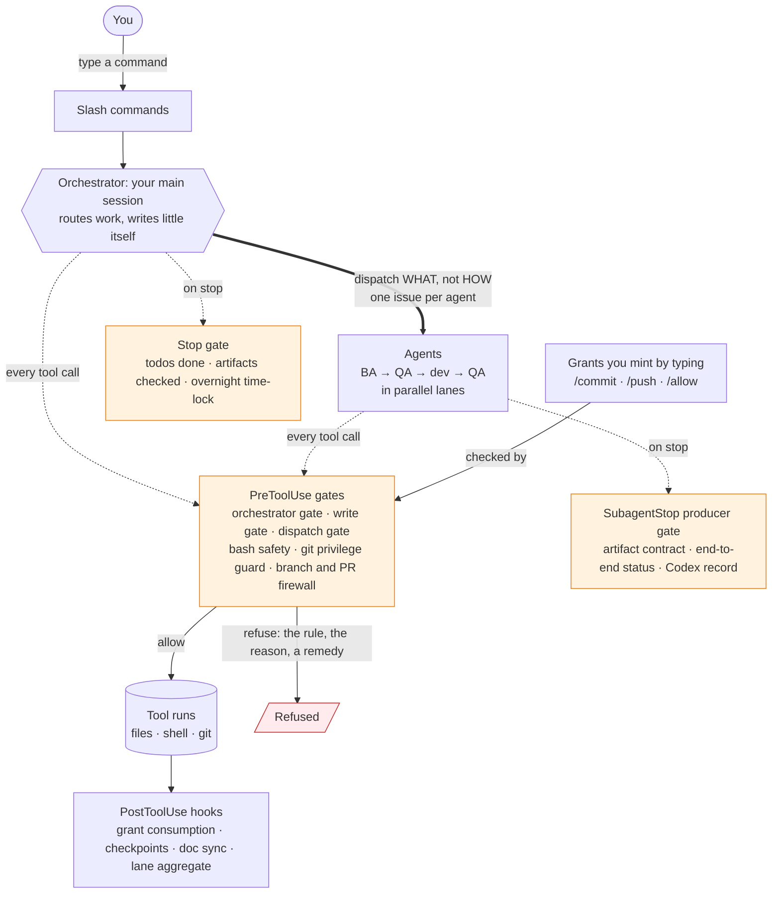
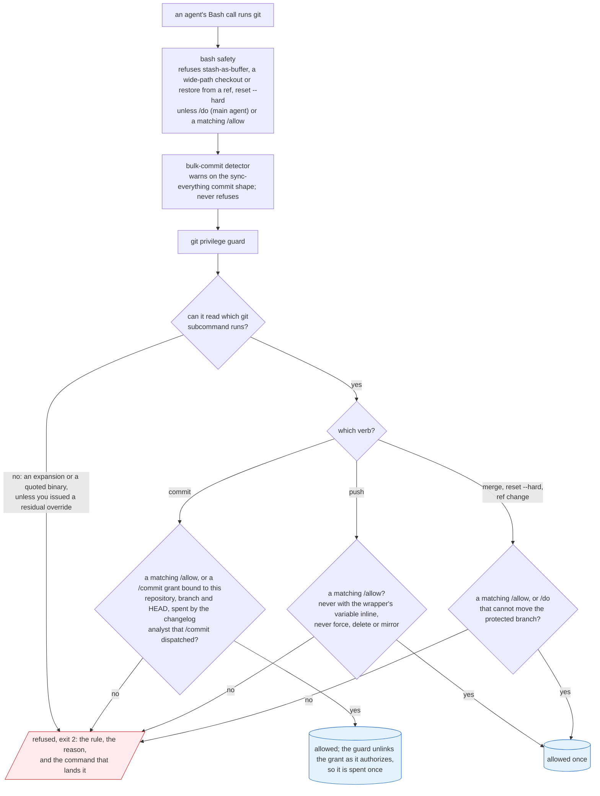
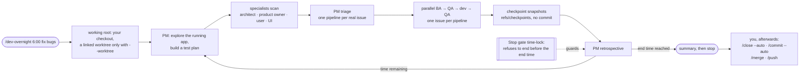

# awesome-claude-harness

An unattended development harness for Claude Code. You give it a requirement. It finds the root cause. It asks you only the decisions that are yours. Then it builds the change and checks it. To land the work, you type `/close`, `/commit` and `/push`. Agents review, commit and push it. No human reviews the code. Prompts guide the agents. Hooks refuse what a prompt can only ask for.

The [status page](docs/status.md) says **what is proven and what is not**. It holds the measured proof, the claim rows and the known limits. The repository generates every figure on it, and CI checks each one again.

<p>

</p>

## At a glance

- **What it is.** It is a configuration for Claude Code. You clone it into `~/.claude`. It holds hooks, slash commands and agent prompts. You import nothing into your project.
- **How it differs.** Many agent setups ask the model to behave. They trust a human reviewer to catch the rest. Here the main session only routes work. One-issue agents analyse, build and verify it. Hooks refuse what a prompt can only ask for. A hook is a script that Claude Code runs around every tool call. A hook refuses these, for example:
  - a push you have not granted;
  - a session that ends with work unfinished;
  - an agent that writes outside its job.

  A grant is a one-time permission. A command you type writes it.
- **How to try it.** Clone the repository and run the init. Watch a guard refuse a push in a sandbox. Then type `/dev <requirement>` in Claude Code. See [Install](#install).

## Feature highlights

| Capability | What it gives you | Grounded in |
|---|---|---|
| **The main session only routes** | The main session routes work. A fresh agent does each real piece of work. Each agent has one job and a clean context. Quality does not decay as the conversation grows. | `hooks/pretool-orchestrator-gate.py`, `CLAUDE.md` |
| **Your words are the spec** | A hook writes your prompt to `docs/dev/user-requirement-<id>.md` before any agent runs. Every agent reads it. No agent works from a retelling. | `hooks/prompt-workflow.py` |
| **You are asked first** | `/spec`, `/dev`, `/redev` and `/dev-command` ask you first, before any analysis is built on. They ask about intent, scope, edge cases and acceptance. They ask in Claude Code's question dialog. Without a spec, several independent BAs work from separate angles. QA checks their evidence first. With a spec, one BA asks what the spec left open. Rounds have no cap. A question you skip settles to its stated default. | `commands/dev.md` (the requirement round), `hooks/lib/requirement_round.py` |
| **BA, QA, dev, QA, each with evidence** | BA is the business-analyst agent. It must cite evidence for the root cause. QA checks the analysis before any code exists. QA checks the implementation after it. Each loop ends on its own only when QA passes. | `commands/dev.md`, `agents/ba.md`, `agents/qa.md` |
| **Parallel lanes, never phases** | A lane is one agent pipeline for one requested outcome. Several outcomes become lanes that run in parallel inside one cycle. No plan may split an outcome into phases. No plan may defer part of it. QA fails a plan that does. | `commands/dev.md` ("One cycle, no phases") |
| **Each dispatch declares what it owes** | Every dispatch declares its obligation. An obligation is the list of artifacts its agent owes, such as reports, analyses and test manifests. A hook checks each artifact against its schema when that agent stops. The agent's context still exists at that point. | `hooks/pretool-obligation-gate.py`, `hooks/subagentstop-artifact-contract-enforce.py` |
| **A Stop gate that holds** | `/dev`, `/close`, `/commit` and the other gated commands cannot end until code confirms their todo list and artifacts. Your `/stop` ends them. | `hooks/stop-launch.py`, `hooks/stop-command-gate.py` |
| **A check before release** | `/close` finishes an unfinished cycle. Inspectors and QA judge the diff. It ends on `CLOSE: YES` or on the findings. Then it asks you to rate the work. | `commands/close.md`, `hooks/posttool-close-rating.py` |
| **One Codex review loop** | With `--codex`, an OpenAI Codex review runs one complete pass. After that it runs only capped re-reviews, and these verify the fixes. Claude classifies every finding and may reject it. Codex never sets the verdict. | `templates/prompt-includes/codex-consultation.md`, `commands/codex.md` |
| **Git protection kernel** | The kernel refuses an agent's `commit`, `push`, `merge` and `reset --hard`. Something you typed must allow each one: `/commit`, `/push` or `/allow`. `/do` never covers a commit or a push. For the main agent and one turn, `/do` releases a merge, a hard reset or a ref change. It does so only when the change cannot move the protected branch. The kernel also refuses a stash used as a buffer and a wide-path checkout, by the shape of the command. | `hooks/pretool-git-privilege-guard.py`, `hooks/pretool-bash-safety.sh` |
| **Grants you mint by typing** | `/commit` writes a grant. The grant works once, expires, and names the repository, branch and HEAD. `/push` needs a token from `/commit`. `/allow` lets one refused operation through once. | `scripts/write-commit-grant.py`, `hooks/push.sh`, `hooks/lib/allowlist.py` |
| **No branch, PR or worktree from an agent** | A hook refuses an agent that creates a branch, a pull request or a worktree. Three cases pass: a live `/dev-overnight`, `/do` for the main agent, and an `/allow` grant for that command. A `--worktree` overnight run creates its worktree under the first case. `/merge` creates no branch. It merges inside its own wrapper. | `hooks/pretool-block-branch-pr-worktree.py`, `hooks/pretool-block-enterworktree.sh` |
| **Overnight runs with nobody watching** | `/dev-overnight 6:00` explores, triages and fixes until a clock time. It commits nothing. The Stop gate refuses to end the session early. You land the work afterwards. | `commands/dev-overnight.md`, `hooks/stop-command-gate.py` |
| **Resume after a usage limit** | `/restart` resumes each interrupted agent by its original id. It never starts a replacement agent. | `commands/restart.md`, `hooks/lib/subagent_restart.py` |
| **Snapshots that never move your branch** | Automatic snapshots go to `refs/checkpoints/<branch>` through git plumbing. Your branch HEAD never moves. `git blame` still points at real commits. | `hooks/lib/checkpoint-core.sh`, `docs/reference/checkpoint-mechanism.md` |
| **Scores from facts, and your rating** | A hook reads what each dispatch actually did. It writes score events. For example: a lane passes QA in its first round. QA pins a failure on BA or dev. Close QA opens a finding after lane QA passed. A dispatch is repeated because a declared artifact went unwritten. A BA panel's root cause is refuted. You pick an option. No agent reports its own score. When an agent starts, a hook shows it its own record. The record holds its score, rank and trend. It lists the good events the agent earned and its latest miss, as facts. It adds a reminder for its rank. It never threatens. The two lowest ranks cost a role extra checking until the score climbs back. A dev's or BA's work then gets one more independent QA round after the normal one. A QA then debates Codex in every round, even without `--codex`. Your `/close` rating counts toward every role that worked on the cycle, and toward the orchestrator. `/rating` shows each agent's score, rank and trend for the project. | `hooks/subagentstart-record.py`, `hooks/lib/score_log.py`, `hooks/lib/score_events.py`, `commands/rating.md` |
| **Generated claims** | The repository computes every figure about itself, on this page and on the status page. CI fails when a figure drifts. CI also fails when someone types a number by hand. | `scripts/generate-hero-status.py`, `scripts/readme_facts.py`, `scripts/verify-claims.sh` |
| **UI-audit skills** | These skills review a UI in a browser. They inject accessibility checks and measure contrast. They hold a catalog of anti-patterns and a state matrix. They check design tokens and give a weighted beauty score. | `skills/` |

## Why this exists

Autonomous coding agents fail in places the field has already documented. Each point below names its source. Then it says what this repository does about it.

- **The field keeps a person in the loop.** Practitioner guides keep a human review before merge ([Augment Code](https://www.augmentcode.com/guides/autonomous-engineering-loop), [Kilo](https://kilo.ai/articles/beyond-autocomplete)). A study looked at 37,623 pull requests that agents wrote. Claude Code's pull requests waited a median of 12.6 hours for a first human review ([arXiv](https://arxiv.org/pdf/2609.17598)). *Here:* the harness asks you first, about what to build. After that it asks only for a decision that the request, the code and sensible defaults cannot settle. Automated verification is the gate before landing. [One paper](https://arxiv.org/abs/2606.13175v1) argues for that approach.
- **Autonomy depends on a person who builds the test oracle.** The parallel-Claude C compiler rested on test suites and verifiers that a human wrote ([Anthropic](https://anthropic.com/engineering/building-c-compiler)). *Here:* the oracle lives in `tests/`. CI runs it on every pull request. Replays drive each pipeline through the real hooks. Fault replays inject failures. The artifact check demands one producer and one reader for every artifact.
- **Instructions are not enforcement.** Hooks are the deterministic layer ([Claude Code docs](https://code.claude.com/docs/en/best-practices)). `CLAUDE.md` is context, not enforced configuration ([Towards AI](https://towardsai.com/p/machine-learning/claude-code-skills-vs-subagents-vs-hooks-vs-workflows-which-to-use-in-2026)). *Here:* a hook carries every rule that must hold. [The ledger](docs/ENFORCEMENT-LEDGER.md) says how far each hook is proven.
- **Claims outrun the code.** Critics of Cursor's agent-built browser found commits that do not compile. They found failing CI on main ([The Register](https://www.theregister.com/2026/01/26/cursor_opinion/)). *Here:* the repository generates every figure about itself. `scripts/verify-claims.sh` fails CI when a figure drifts.

**What still needs you:**

- your answers to the requirement round at the start of a cycle;
- the decisions only you can make;
- your rating of the work.

`/close` asks for the rating after a cycle lands. You may skip it. The rating counts toward the score of every agent that worked on the cycle. `/dev-overnight` asks nobody. It decides by experiment, else by the question's default. It lists each decision in its summary.

## Install

You need `python3`, `git` and `jq`. You need Claude Code to use the harness. Codex is optional. Only `--codex` and `/codex` use it, and they need the OpenAI Codex CLI.

### Full install: clone + init

```bash
git clone https://github.com/Yugoge/awesome-claude-harness.git ~/.claude   # needs an empty ~/.claude
~/.claude/scripts/bootstrap                                # init: asks once per optional module; ends with the preflight
python3 ~/.claude/scripts/capture-hero-run.py --check-only # sandboxed demo: a push refused, allowed once by a grant, refused again
```

The demo writes nothing into the checkout. It prints where it saved its log. Then, in Claude Code, type `/dev <your requirement>`.

### Guardrails only: the installer core profile

This profile installs the guardrails without the agents and commands. Run it from a checkout:

```bash
scripts/install/install --profile core   # guardrails in an isolated directory; hook registrations merged additively
```

`git clone` refuses a target that is not empty. If `~/.claude` already holds your settings, move it aside. Or use one of the [other install locations](docs/installation.md#other-install-locations). The [installation guide](docs/installation.md) also covers the settings overlay, optional modules, dependencies and troubleshooting.

## System architecture



- **Orchestrator**: your main Claude Code session. It routes work to agents. A hook limits what it may do itself.
- **Hook**: a script that Claude Code runs before or after a tool call, or at a stop. A hook refuses an action by exiting with code `2`. Related hooks run as rules inside one registered gate. Each rule keeps its own decision.
- **Grant**: a permission that you mint by typing a command. It lets one operation through, and a hook checks it.
- **Ledger**: [`docs/ENFORCEMENT-LEDGER.md`](docs/ENFORCEMENT-LEDGER.md). It has one row per registered hook. Each row says what the hook does and how far that is proven.

## The full pipeline

```
   /spec                          optional: ask you first, then write a durable spec with per-agent briefs
     │
     ▼
   /dev · /redev · /dev-command   ask you first → BA → QA of the analysis → dev → QA, one-issue lanes in parallel
   /dev-overnight                 unattended until an end time; commits nothing
   /do                            the main agent does one task itself, for one turn
     │
     ▼
   /close                         release readiness: inspectors and QA judge the diff; CLOSE: YES or the findings
     │
     ▼
   /commit                        the changelog analyst stages the task's own files under a single-use grant
     │
     ▼
   /merge · /push                 a real merge into the default branch · the push wrapper, after the push analyst
```

Each stage hands a checked artifact to the next. You start each stage with one command. Agents do all the work inside it. Nobody reviews the code by hand. Only `/dev-overnight` needs no command from you until its end time.

- **One cycle, parallel lanes.** `/dev` splits your requirement into outcomes that can each be verified alone. Each outcome gets one lane. BA, QA, dev and QA run once per lane, in parallel batches. A failing lane retries alone. The cycle passes only when every lane's QA passes. A plan that splits an outcome into phases fails validation. So does a plan that defers part of an outcome to a later cycle.
- **A loop ends on a pass, or when you stop it.** The analysis loop and the build loop each end on their own only when QA passes. No round cap exists. Your `/stop` or Esc interrupts either loop at any time. So a stubborn failure loops until you stop it. The [status page](docs/status.md) lists this limit.
- **One Codex loop, and Codex has no veto.** You can add `--codex` to `/dev` and its variants, `/spec`, `/clean`, `/close` or `/commit`. An agent then asks Codex once for a complete review. After that it asks Codex only to verify fixes, a capped number of times. Claude classifies every finding as a real bug, a minor point, out of scope or a nitpick. Claude may reject a finding with a reason.
- **You are asked first, then only when it matters.** The requirement round asks you first, before any analysis is built on. It asks about intent, scope, edge cases and acceptance. It uses plain product terms. It never asks a code-level choice that a measurement can settle.
  - Without a spec, a panel of independent BAs analyses the requirement from separate angles. One traces the root cause in the code. One looks for the smallest change. One looks at your intent. Panel QA checks each piece of evidence they cite. Only a verified root cause becomes an option. The recommended option comes first.
  - With a spec, one BA asks what the spec left open.
  - The orchestrator asks each round word for word in Claude Code's question dialog. A hook writes your answers to disk. The dispatch gate refuses the next agent until the round is asked.
  - You may skip a question. Each question names the default it settles to. Rounds have no cap.
  - Later, an agent may need a decision. It writes one question with options and a default. The orchestrator asks it the same way.
  - The Stop gate refuses to end a turn on a question asked in plain text.
- **Scores come from facts, not from claims.** A hook reads the cycle's transcripts and reports after each dispatch returns, and after your rating. It appends score events to the project's score log. It writes a repeated event once. Scores, ranks and trends are computed when read and never stored. `/rating` prints them and writes nothing. At a dispatch, a hook shows the agent its own record in at most three lines. A low record adds the extra QA round or the Codex debate. The Stop gate and the Codex gate hold that extra work.
- **Grants start from a command you type.** A grant is a permission that a hook checks. It lets one operation through. Only a command you type starts the path that writes one:
  - `/commit` for a commit;
  - `/push` for a push, where the push analyst writes the grant;
  - `/allow` for one refused operation.

  The [trust model](#trust-model-in-practice) below says who may use which.

## Failure modes this exists to prevent

| Failure mode | Harness mechanism | Key file |
|---|---|---|
| An agent does too much in one context, and quality silently degrades | The orchestrator gate keeps the main session routing. A one-issue agent with a clean context does each piece of work. | `hooks/pretool-orchestrator-gate.py` |
| The implementation drifts from the requirement | A hook writes your words to disk before any agent runs. BA cites evidence. QA checks the analysis before any code. | `hooks/prompt-workflow.py`, `agents/ba.md`, `agents/qa.md` |
| Agents build what they guessed you meant. A question asked in chat is lost when the turn ends. | The requirement round asks you first, in the question dialog. No agent is dispatched until the round is asked. A hook writes your answers to disk. The Stop gate refuses to end a turn on a question in plain text. | `hooks/lib/requirement_round.py`, `hooks/pretool-obligation-gate.py`, `hooks/stop-command-gate.py` |
| A requested outcome quietly becomes "phase two" | One cycle runs parallel lanes. QA fails a plan that phases or defers a requested outcome. | `commands/dev.md` |
| A missing artifact shows up only at `/close`, after the producer's context is gone | Each dispatch declares what its agent owes. A hook checks the contract when that agent stops. | `hooks/pretool-obligation-gate.py`, `hooks/subagentstop-artifact-contract-enforce.py` |
| QA runs before every lane has returned | Under the shipped settings, the dispatch gate refuses QA's dispatch in three cases: a declared lane has no report, the aggregate report is missing, or the aggregate report does not name every lane. | `hooks/pretool-aggregate-check.py` |
| A false pass ships a broken feature | QA starts from doubt and fails when in doubt. Its report must record the end-to-end status. | `agents/qa.md`, `hooks/subagentstop-e2e-enforce.py` |
| A second model's opinion is taken as the verdict | Claude classifies every Codex finding and may reject it. Codex never sets the verdict. | `templates/prompt-includes/codex-consultation.md` |
| Unfinished work is handed off as done | The Stop gate refuses the stop until every todo is complete and the artifact chain passes. | `hooks/stop-command-gate.py` |
| An agent writes outside its job | Each subagent may write only to its role's paths. | `hooks/pretool-tool-policy.py`, `policies/tool-policy.v1.json` |
| An irreversible git operation, such as a wide checkout over uncommitted work, or a bulk commit or push that nobody reviewed | Agent commit, push, merge and `reset --hard` are refused by default. A stash used as a buffer and a wide-path checkout are refused by the shape of the command. | `hooks/pretool-git-privilege-guard.py`, `hooks/pretool-bash-safety.sh` |

## Context-engineering guardrails

These hooks keep the main session's context small. The real work then happens in the agents' clean contexts.

| Guardrail | What it refuses | Why | Hook |
|---|---|---|---|
| Bash streak cap | The main agent's next `Bash` call after a short run of them. The cap lifts when it dispatches an agent or you type the next prompt. | The main agent delegates before shell output floods its context. | `hooks/pretool-orchestrator-gate.py` |
| Once per turn | A second call in one turn, by the main agent, of the same tool outside the always-allowed list (`Edit`, `Write`, `WebFetch`, ...) | Real edits belong in an agent's clean context. | `hooks/pretool-orchestrator-gate.py` |
| Read-size cap | The main agent reading a large file whole instead of a slice | One file must not swamp the context. The main agent delegates and asks for a summary. | `hooks/pretool-read-size-guard.py` |
| Write over existing | `Write` onto a file that already exists. The change goes through `Edit` instead. | A whole-file rewrite from memory loses content, and no diff catches it. | `hooks/lib/write_gate/overwrite.py` (in the write gate) |
| No background dispatch | An agent dispatch without `run_in_background: false`, and every ordinary `SendMessage` | A background agent escapes the pipeline's checks. Only `/restart`'s recovery message may resume one. | `hooks/pretool-block-background-tasks.py` |
| Gitignored deliverable | A dispatch whose dev report names a deliverable that `.gitignore` matches | Such a cycle passes QA but can never ship through git. | `hooks/pretool-gitignore-preflight.py` (in the dispatch gate) |
| Todo sequence | A `TodoWrite` that skips, reorders, edits or bulk-completes steps | The plan stays a record you can audit, one step at a time. | `hooks/pretool-todo-validate.py` |

## The git protection kernel

The kernel guards against the damage an agent can do with git. Two cases drove its design:

- An agent uses a stash as a scratch buffer, then runs a wide-path checkout. Together these can silently overwrite uncommitted work.
- An agent runs a bulk "commit and push everything". The work lands and nobody signs off.

Every agent `git` command passes through the Bash hooks below. They run in the order `settings.json` registers them. The guard is always on. It covers the main agent and every subagent, interactive or overnight.



`/push` and `/merge` run their git inside their own wrappers, `hooks/push.sh` and `hooks/merge.sh`. Each wrapper runs in a subprocess that no hook sees. Each wrapper decides by its own grant or token. `push.sh` exits with code `3` when it has no token from `/commit`. These stay free:

- read-only git: `status`, `log`, `diff`, `show`, `blame`;
- `add`;
- a checkout or `restore` of a single file;
- `stash list`, `show` and `pop`.

[The git protection kernel](docs/git-protection-kernel.md) lists what each guard does not see.

## The overnight pipeline



`/dev-overnight` runs in your checkout by default. With `--worktree` it runs in a linked worktree. It runs until a clock time. If you give no time, it uses the default in `commands/dev-overnight.md`. The Stop gate refuses to end the session before that time. After that time, the session ends once the PM retrospective and the overnight summary are on disk.

Nobody is asked anything. A pipeline may need a decision. An experiment makes it, else the question's default does. The summary lists each one under "Decisions made without the owner". Nothing is committed. The work waits in `refs/checkpoints/<branch>` until you land it. A typed `/stop` ends the run at once.

An in-place run has no worktree boundary. A `--worktree` run shares the repository's git directory. [The overnight pipeline](docs/overnight-pipeline.md) says what each mode does and does not protect.

## Trust model in practice

The table shows who may do what, and which grant lets an operation through. [The git protection kernel](docs/git-protection-kernel.md) describes the full grant lifecycle.

| Actor | Edit, Write | git commit | git push | git reset --hard | Break-glass |
|---|---|---|---|---|---|
| You, in your own shell | yes | yes | yes | yes | not needed |
| Main agent | Once per tool per turn. Free under `/do`. | Not itself. Only the changelog analyst that `/commit` dispatches spends the `/commit` grant. Or a matching `/allow`. | Through `/push`, or a matching `/allow` | Under `/do` when it cannot move the protected branch, or a matching `/allow` | `/do` for one turn. `/do` never covers commit, push or protected files. `/allow` for one operation. |
| Subagent | Its role's write paths | Only the changelog analyst that `/commit` dispatched, under that grant | A matching `/allow` only | A matching `/allow` only | `/allow` only. Subagents never get `/do`. |

The commit grant works once and expires. The guard spends it as it authorizes the commit. An `/allow` grant matches the command's structure, or an anchored pattern on one sub-command. It never matches a substring of the raw text. It expires. It is consumed once the call it matched has ended, whatever the result.

## Pipeline in action

### Walkthrough: `/dev "the login button is misaligned on mobile"`

| Step | Who acts | What happens |
|---|---|---|
| Capture | `UserPromptSubmit` hook | `hooks/prompt-workflow.py` writes your words to `docs/dev/user-requirement-<id>.md`. It arms the cycle before any agent runs. |
| Plan | Orchestrator | It splits the requirement into outcomes. Here there is one lane. It marks each specialist RELEVANT or SKIP and gives a reason. A layout bug makes `ui-specialist` relevant. Its findings go to BA. |
| Ask first | BA panel, panel QA, you | There is no spec, so BAs analyse independently. One traces the root cause in the code. One looks for the smallest change. One looks at your intent. Panel QA checks the evidence each one cites. It drops a cause it cannot verify. It turns their disagreements into one round of questions: what you should see on a phone, how far the fix should go, and which screens count as done. You answer in the question dialog, or you skip. No agent is dispatched until the round is asked. |
| Analyse | BA | The BA whose option you chose builds on your answers. If you chose none, the BA whose root cause QA verified does. It finds the file and the cause that actually produce the misalignment, not a plausible cousin. It cites file and line, search results and git history. It writes the ticket, the context and the acceptance criteria. It ties each answer to the criteria it shaped. A point that still needs you becomes the next round. |
| Check the analysis | QA | QA validates BA's work before any code. It checks that the evidence is real. It checks that the scope is the one you asked for. It checks that nothing was narrowed, renamed or deferred. A failing analysis goes back to BA. The loop repeats until QA passes. |
| Build | Dev | Dev implements the checked plan. It makes the smallest change that meets the acceptance criteria. It reports what it changed and ran. With several lanes, one dev per lane runs in parallel. A hook assembles their reports. |
| Verify | QA | QA drives the running product against the acceptance criteria, on desktop and mobile. A warning or a failure sends dev back with QA's report. This repeats until QA passes or you stop it. |
| Hold | Stop gate | The session cannot end while a todo is open or an artifact fails its check. Your `/stop` ends it at any time. |
| Land | You | `/close` has inspectors and QA judge the diff. It asks for your rating. Then it shows each agent's score, rank and trend, and what this cycle earned or cost. `/commit` commits the task's files under a grant that works once. `/push` publishes through the wrapper. |

### Walkthrough: a hook firing

An agent tries the obvious shortcut. It sets the push wrapper's own environment variable on the command line:

```bash
CLAUDE_PUSH_COMMAND_ACTIVE=1 git push
```

`hooks/pretool-git-privilege-guard.py` runs before the tool executes. It finds the wrapper's variable name in the raw command text. It refuses the call with exit code `2` and prints `BLOCKED: agent git push - inline-env injection blocked`. This check runs before the guard reads any `/allow` grant or push grant. `/do` does not cover pushes. So nothing the agent can arrange lets this form through.

| What the agent runs | Result |
|---|---|
| `CLAUDE_PUSH_COMMAND_ACTIVE=1 git push` | Refused with exit `2`. The guard sees inline environment injection and decides before it reads any grant. |
| `git push` | Refused with exit `2`. Agents may not push from an agent context. The message points to `/push`. |
| `/push`, typed by you | The push analyst reviews what would go out and writes a grant. `scripts/execute-push.py` validates the grant, spends it, and hands over to `hooks/push.sh`. `push.sh` refuses with exit `3` unless a token from `/commit` names an ancestor of HEAD. It refuses force, delete and mirror pushes. |

The guard steers the model toward the right path and stops it on the wrong one. The refusal names the right path. The install's demo replays the plain `git push` case in a sandbox. The guard refuses it. A single-use `/allow` grant then lets it through exactly once, and the real consumer spends the grant. The guard refuses it again. The [status page](docs/status.md) holds the recording.

### Usage examples

```bash
# Orchestrated development; a vague requirement is fine
/dev add a --dry-run flag to the export command

# Several outcomes in one cycle: parallel lanes, never phases
/dev fix the pagination off-by-one and add a CSV export to the report page

# With a Codex review of each agent's draft
/dev --codex fix the off-by-one in pagination

# Land the work
/close
/commit
/push

# Unattended until 6am, focused on one subsystem; land it afterwards
/dev-overnight 6:00 fix flaky tests in the parser

# End an overnight run early
/stop
```

## The cast of agents

The orchestrator dispatches each agent by describing the problem. It never names the tooling. `hooks/pretool-orchestrator-prompt-purity.py` warns when a dispatch names a tool. Each agent works one issue in a clean context. It returns a structured report. The table below is generated from each agent's own file.

<!-- BEGIN canonical-region id=agents — generated by scripts/generate-hero-status.py; do not hand-edit -->
| Agent | What it does |
|---|---|
| `architect` | Reviews architecture: structural issues, technical debt, dependency problems and inconsistent patterns. |
| `ba` | Writes the requirement round's questions, finds the root cause with cited evidence, alone or on a panel, and writes the ticket, context and acceptance criteria. |
| `changelog-analyst` | Stages a task's files, writes the conventional commit message and the push-gate token; dispatched only by /commit. |
| `cleaner` | Applies the cleanup actions approved from the inspectors' reports and reports what it did. |
| `cleanliness-inspector` | Finds misplaced docs, duplicates, temporary files and build artifacts, and recommends a cleanup. |
| `dev` | Implements the analysed plan with the smallest change that passes the acceptance criteria, and reports what it changed and ran. |
| `git-edge-case-analyst` | Mines git history for edge cases and past violations, and recommends how to prevent them. |
| `graphify` | Refreshes the optional code-graph cache and extracts the subgraph around the change for dev and QA; it analyses nothing itself. |
| `merge-analyst` | Checks divergence, conflicts and overnight state before a merge and writes a short-lived merge grant; dispatched only by /merge. |
| `pm` | Runs the overnight cycle's planning: a test plan from exploring the running app, triage of the specialists' issues, and the retrospective. |
| `product-owner` | Checks product logic: consistency, feature completeness, user flows and business-logic bugs. |
| `prompt-inspector` | Finds verbose, non-functional text in command and agent prompts. |
| `pull-analyst` | Summarizes the risk of the commits a pull brought in; advisory, it writes no grant and blocks nothing. |
| `push-analyst` | Checks what a push would publish for sensitive files, divergence and branch protection, and writes the push grant; dispatched only by /push. |
| `qa` | Checks a BA panel's evidence and writes your first questions; verifies the analysis before any code and the implementation after it; when in doubt it fails. |
| `rule-inspector` | Discovers each folder's organisation rules from git history and documents them. |
| `spec` | Splits a spec into the briefs each agent needs and adds checkpoints; dispatched by /spec. |
| `style-inspector` | Audits development standards: no hardcoding, naming, environment use, step numbering, language and concise documentation. |
| `test-executor` | Runs the project's script and instruction tests and reports the results. |
| `test-validator` | Checks the tests' syntax, dependencies and quality before they run. |
| `test-writer` | Writes failing test skeletons from the acceptance criteria and keeps the task's test manifest; dispatched for standard or risky tasks. |
| `ui-specialist` | Reviews visual design: design-system adherence, consistent styling, responsive layout and component quality, with a beauty score. |
| `user` | Simulates an end user: tries real usage scenarios and reports broken flows, friction and confusing behaviour. |

23 agents, generated from the frontmatter of `agents/*.md`.
<!-- END canonical-region id=agents -->

## The command surface

These are the commands you type. An owner-only command carries `disable-model-invocation: true` and a `Skill(...)` deny in `settings.json`. So an agent cannot start one itself. The table below is generated from each command's own file.

<!-- BEGIN canonical-region id=commands — generated by scripts/generate-hero-status.py; do not hand-edit -->
| Command | Group | Typed by | What it does |
|---|---|---|---|
| `/spec [--codex] [<requirement>]` | Spec | owner only | Ask you about the requirement first, then write a durable spec and split it into per-agent briefs with checkpoints, for /dev or /dev-overnight to build from. |
| `/spec-update [--update --spec <path> \| --continue \| --temp] [--spec <path>] [what the next session should focus on]` | Spec | owner only | Turn unfinished work into a continuation spec for a fresh session, enrich an existing spec, or write a short session note. |
| `/dev [--codex] [--spec <path>] <requirement>` | Develop | owner only | Build a requirement end to end: ask you first, then BA finds the root cause, QA checks it, dev builds in parallel one-issue lanes, QA verifies until it passes. |
| `/dev-command` | Develop | owner only | The /dev workflow for building a slash command, a subagent or another harness file, with the differences such a file needs. |
| `/dev-overnight` | Develop | owner only | Run unattended until an end time: explore, fix each real issue in its own pipeline, decide without the owner, and commit nothing. |
| `/redev [--codex] [--spec <path>] [<requirement>]` | Develop | owner only | Start a fresh /dev cycle in the same conversation without repeating the text of /dev, to save context. |
| `/checkpoint` | Ship | owner only | Snapshot the working tree to the safety ref `refs/checkpoints/<branch>` without moving HEAD, touching the index or pushing. |
| `/close [--codex \| --auto \| --late-repair] [<task-id>\|<path>]` | Ship | owner only | Close the cycle: finish what is unfinished, have inspectors and QA judge it, end on `CLOSE: YES` or the findings, then ask you to rate it. |
| `/commit` | Ship | owner only | Commit a task's changes through the changelog analyst, closing an unfinished cycle first and staging only the task's own files. |
| `/merge` | Ship | owner only | Merge a branch or commit into the default branch with a real merge that keeps the full history, after a pre-merge analysis. |
| `/pull` | Ship | owner only | Pull with rebase, stashing and restoring local changes and stopping on conflicts, then summarize the risk of what arrived. |
| `/push` | Ship | owner only | Publish the current branch through the push wrapper after the push analyst reviews what would go out; it needs a commit made by /commit. |
| `/clean [--codex]` | Quality | owner only | Clean up the project: inspectors find misplaced docs, byproducts and style violations, and the cleaner applies the approved fixes. |
| `/test` | Quality | owner only | Check the project's tests against edge cases found in its git history, then run them and report. |
| `/allow` | Control | owner only | Grant one single-use permission for an operation a grant-aware safety hook refused; it never overrides a settings deny rule. |
| `/codex [prompt or --review or --model <model> <prompt>]` | Control | owner or agent | Ask OpenAI Codex for a second opinion, a code review or a delegated coding task, through an isolated wrapper. |
| `/do` | Control | owner only | Let the main agent do one task itself for this turn, past the orchestrator gate; it does not cover commits or pushes. |
| `/harness off \| on \| status` | Control | owner only | Switch the whole harness off or back on for this harness home, or show its state; on restores exactly what off removed. |
| `/rating` | Control | owner only | Show every agent's score, rank, trend and latest scored events for this project, then your latest ratings; it writes nothing. |
| `/restart` | Control | owner only | Resume every subagent a usage limit interrupted, by its original agent id; with none to resume, continue the main agent. |
| `/stop` | Control | owner only | End the overnight run before its end time, or any command the Stop gate holds; only the owner can type it. |
| `/tickets [--format table\|json]` | Control | owner or agent | Print a read-only table of every ticket, spec and lane, with its state and next action. |

22 commands, generated from the frontmatter of `commands/*.md`. An optional module's own commands are described with the module in the [installation guide](docs/installation.md).
<!-- END canonical-region id=commands -->

Did you hit a usage limit? `/restart` resumes every recoverable interrupted child in the current parent transcript by its original agent id. It never creates a replacement agent.

## Design philosophy

| Principle | Binding rule | Enforced by |
|---|---|---|
| Hooks decide, prompts guide | A hook carries each rule that must hold, and refuses with exit code `2`. Prompts carry judgment and point at the hook. | `hooks/pretool-git-privilege-guard.py`, `hooks/pretool-bash-safety.sh`, the ledger |
| Rules, not stories | Every agent prompt that touches infrastructure says what is forbidden, not only what is allowed. | `agents/ba.md`, `agents/dev.md`, `CLAUDE.md` |
| The orchestrator says WHAT; the agent decides HOW | A dispatch prompt names no tool and no shell command. | `hooks/pretool-orchestrator-prompt-purity.py` (a warning, never a block) |
| One agent, one issue | Several outcomes become parallel lanes in one cycle. Nothing is bundled. Nothing is split into phases. | `CLAUDE.md`, `commands/dev.md` |
| Your exact words are the contract | The literal requirement is on disk before any agent runs. Every agent reads it. | `hooks/prompt-workflow.py`, `agents/ba.md` |
| No flow may strand you | CI fails a replay that reaches a blocking site no action clears. No hook gates `/stop` or Esc. | `tests/replay/test_no_dead_end.py` |
| One producer per fact | Every artifact has one producer and a reader that decides on it. The repository generates every figure about itself. | `tests/test_artifact_graph.py`, `scripts/generate-hero-status.py` |
| Fail closed, leave forensics | The hooks refuse an ambiguous grant. They count a verdict they cannot parse as a failure. The evidence stays on disk. | the gate hooks, `hooks/pretool-git-privilege-guard.py` |

## FAQ

**Is this a framework I import?** No. It is a configuration for Claude Code. Its hooks, commands and agents change how every session behaves. It has no package and no API. It does not work with other agent clients without substantial changes.

**Does the orchestrator-only rule make small edits slow?** Not for a one-line fix. Type `/do <task>`, and the main agent does the task itself for one turn. Commits and pushes still go through `/close`, `/commit` and `/push`.

**Can an agent switch off its own guardrails?** The design makes it hard, not impossible:

- An agent cannot start an owner-only command.
- The git guard refuses every agent by default.
- Each grant works once.
- A hook refuses agent writes to a project's `.claude/hooks/` and `.claude/commands/`. The owner can allow them by placing a sentinel file.

The [status page](docs/status.md) lists what is not covered.

**Can I use it with a team or in CI?** It is built for one developer per `~/.claude`. Grants belong to one session. Hooks fire only when Claude Code runs. The test suite runs without Claude Code (`scripts/test`). CI runs it on every pull request.

**Where are the numbers?** On the [status page](docs/status.md). It counts the replayed pipelines, the injected faults, the blocking sites found and the tests. It says what each one proves and what it does not.

## Extending it

Follow the existing conventions. A prompt states what is required and what is forbidden. A hook that guards anything dangerous fails closed and says why. [Extending the harness](docs/extending.md) has details and examples.

| Extension | File | Required | Checked by |
|---|---|---|---|
| Slash command | `commands/<name>.md` | `description:`, plus `summary:` and `group:` for the command table | The table's generation fails on a missing or over-long summary, or on an unknown group. |
| Agent | `agents/<name>.md` | `name:` and `description:`, plus `summary:` for the cast table | The same generation, for the cast |
| Hook | `hooks/<name>.py` or `.sh`, registered in `settings.json` | Exit `2` to refuse and `0` to allow. Register it through the harness-home path. | `scripts/doctor` fails when a registered hook path does not resolve. |
| Owner-only command | As above, with `disable-model-invocation: true` | A `Skill(<name>:*)` entry in the deny list of `settings.json` | `hooks/tests/test_skill_deny_coverage.py` |

## Documentation

- [Status](docs/status.md): the measured proof, the demo recording, the claim rows and the known limits.
- [Installation](docs/installation.md): clone and init, the settings overlay, optional modules, the guardrails-only profile, dependencies and troubleshooting.
- [How it works](docs/how-it-works.md): the architecture, the agents, the guardrails and the project structure.
- [The git protection kernel](docs/git-protection-kernel.md): what git operations are refused, how grants work, and what each guard does not see.
- [The overnight pipeline](docs/overnight-pipeline.md): `/dev-overnight` until a clock time.
- [Extending the harness](docs/extending.md) and the longer [FAQ](docs/faq.md).
- [The enforcement ledger](docs/ENFORCEMENT-LEDGER.md), the [threat model](docs/THREAT-MODEL.md) and the [adversarial corpus](docs/ADVERSARIAL-CORPUS.md).
- [`CLAUDE.md`](CLAUDE.md), [`ARCHITECTURE.md`](ARCHITECTURE.md) and the [changelog](CHANGELOG.md).

## Acknowledgements

This configuration grew out of these sources, and remains grateful to them:

- [Claude Code](https://claude.com/claude-code) and the official [documentation](https://docs.claude.com/en/docs/claude-code).
- [fcakyon/claude-codex-settings](https://github.com/fcakyon/claude-codex-settings), an early real-world configuration reference.
- The broader Claude Code community. Its shared patterns and hard-won lessons shaped the hooks and agents here.

## License

Released under the **MIT License**. You may use, copy, modify and adapt it for your own `~/.claude`. Source: [this repository](./).
