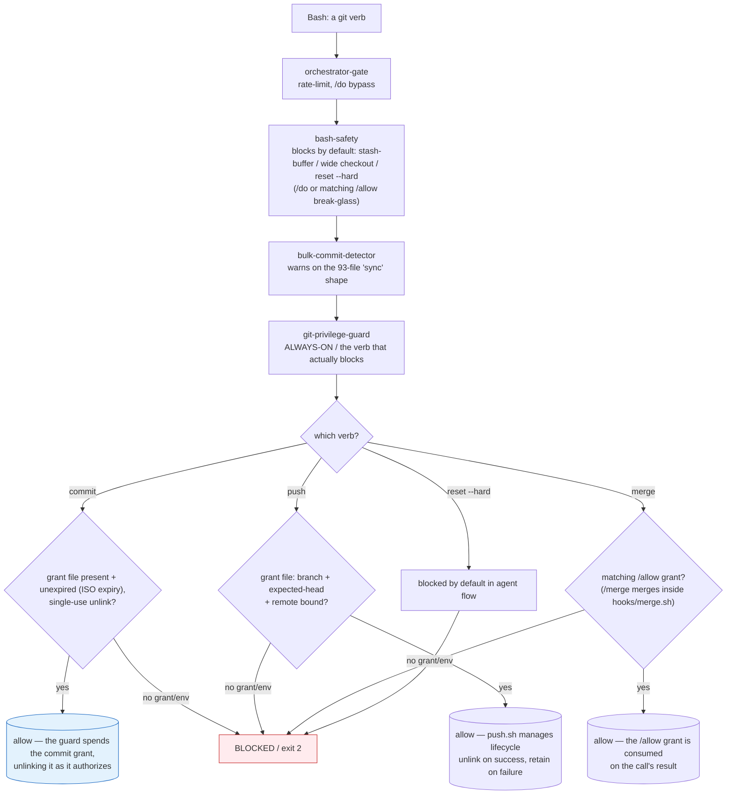

# The git protection kernel

What the harness refuses in git, what it needs before it allows a commit, push or merge, and what each guard does not see.

[Back to the README](../README.md)

## The git protection kernel

Two failure classes drove its design:

> **Overwriting uncommitted work.** Using `git stash` as a throwaway buffer plus a wide-path `git checkout <ref> -- .` can silently overwrite uncommitted work with an old baseline. So `hooks/pretool-bash-safety.sh` now blocks **stash-as-buffer** (`git stash push/save/-u/--all` and bare `git stash`), **wide-path checkout-from-a-ref** (`git checkout <ref> -- .` / `-- *` / `-- dir/`), its modern `git restore --source=… -- .` equivalent, and **every `git reset --hard` form** — each blocked **by default**, absent a main-agent `/do` or a matching `/allow` grant. Single-file checkout (`git checkout <ref> -- path/to/file.ts`) stays allowed.
>
> **Concrete example:** if an agent tries `git checkout abc123 -- .`, bash-safety blocks it with exit 2. To restore a single file: `git checkout abc123 -- hooks/pretool-bash-safety.sh` — that is allowed. To widen the checkout back to a whole directory, a human must first `/allow git checkout` with the matching `args_contain`.

> **Bulk unreviewed commit + push.** A bulk "commit and push everything" request can produce a large multi-subsystem commit with no human sign-off. Gating on overnight-context alone would let this class through, so `hooks/pretool-git-privilege-guard.py` is **always-on** — it runs on every Bash call in both subagent and main-agent contexts — and requires a per-operation authorization grant for each privileged verb.



#### Hook chain reference

Note: `pretool-bulk-commit-detector.py` is warn-only — it exits 0 and never blocks by itself; the blocking of agent commit/push is the privilege-guard's job.

| Hook | Event | Covered operations | Default | Break-glass |
|---|---|---|---|---|
| `pretool-bash-safety.sh` | PreToolUse Bash | stash-buffer, wide checkout (-- . / -- *), git restore --source -- ., reset --hard | BLOCK (exit 2) | /do or matching /allow |
| `pretool-bulk-commit-detector.py` | PreToolUse Bash | 93-file 'sync all uncommitted' shape (3+ subsystems + sync subject) | WARN only (exits 0) | N/A — warn-only per current policy |
| `pretool-git-privilege-guard.py` | PreToolUse Bash | commit, push (any form), merge, reset --hard, direct ref mutation | BLOCK (exit 2) | /commit or /push grant, or /allow (subagents too); /do (main agent only). An agent's own `git merge` has no grant: `/merge` merges inside `hooks/merge.sh` |
| `pretool-orchestrator-gate.py` | PreToolUse (all tools) | Non-whitelisted tools in main-agent context; streak rate-limit | BLOCK (rate-limited) | /do |
| `pretool-tool-policy.py` | PreToolUse (all tools) | For every caller including the main agent: a write, delete or rename of a protected file (the harness home's commit engines, git hooks and config, `.gitattributes`, overlay and private-literal list; session transcripts; /do task sidecars), a ScheduleWakeup prompt typing a harness command outside CONTROL, and a write (Write/Edit/MultiEdit/NotebookEdit or a Bash write target) to a path another dispatch's obligation declares; then a subagent's role-scoped deny rules from policies/tool-policy.v1.json | BLOCK (exit 2); for the role rules FAIL CLOSED (non-dev roles), fail-safe ALLOW (dev role when policy missing) | N/A |
| `stop-command-gate.py` (time-lock, behind `stop-launch.py`) | Stop | Session end before the declared end-time, then while the wake has no CronDelete; a `/dev-overnight` Stop after it until the closeout is on disk | BLOCK (exit 2) | A human-typed /stop releases the window at any time; after end-time, a PM retrospective report and an overnight summary written since the start release the closeout; end-time defaults to 8h if none is set |
| `posttool-doc-sync.py` | PostToolUse | INDEX.md / README / CLAUDE stat block regeneration | UPDATE (idempotent) | N/A |

Read-only git (`status`, `log`, `show`, `diff`, `blame`, `ls-files`, `branch` listing, `stash list/show`) stays freely available. `add`, single-file working-tree `restore`, and `stash pop` are also permitted — they mutate the index or working tree but never history or the remote.

#### Grant lifecycle comparison

| Grant type | Written by | Key fields | Expiry | Consumed on | Honored for |
|---|---|---|---|---|---|
| Commit grant `/tmp/claude-commit-grant-<sid>-<nonce>.json` | /commit command (`scripts/write-commit-grant.py`) | task_id, nonce, repo_root, branch, expected_head, expires_at (ISO-8601 UTC), minted_by | Time-boxed ISO expiry | Spent by the privilege guard when it authorizes the commit: it unlinks the grant (only one event can win) and leaves a per-event pointer from which `posttool-allowlist-consume.py` writes the commit journal entry; a failed commit does not get it back (its retry takes a fresh grant); validation failures do NOT consume the grant | The changelog-analyst dispatch /commit made (a live dispatch attestation carrying the digest of its dispatching prompt) |
| Push grant `/tmp/claude-push-grant-<sid>-<nonce>.json` | /push command | nonce, branch, expected-head SHA, remote | None — branch/head/remote-bound | Unlinked by `push.sh` after a successful `git push`; left in place on failure (for retry). The privilege guard does not fire on `push.sh` subprocesses — `push.sh` manages the lifecycle directly. | Main agent + subagents |
| /allow sentinel `/tmp/claude-grants/<task_id>.json` | /allow command | task_id, session_id, allowed_operations[] ({op, target?, args_contain?}), expires_at | ISO expiry | Any terminal result (posttool-allowlist-consume.py) | Main agent + subagents |

Match channel for /allow: structural (`op` = first token of sub-command; `args_contain` = leading argument sequence prefix). Command-text substring grep is not the match channel. Refuse-by-default is the rule — the match-all hole was closed; the grant is single-use and consumed on any terminal result. The structured sentinel is the only `/allow` grant: no pattern-string grant is written or read.

## Commit protection: the pre-commit hook and the private-literal list

The pre-commit hook init installs (`hooks/git-hooks/pre-commit`) refuses a commit, naming the
failed check, when:

- `settings.json` is staged in machine form — it carries values the overlay or the record of
  what render applied lists, or CLI-owned keys, or is not canonical
  (`render-settings check --staged`);
- `settings.machine.json` or `private-literals.txt` is in the index, force-added or tracked
  by an earlier commit (`render-settings check --staged`): both are personal, so every commit is
  refused until `git rm --cached -- <path>` untracks it (the file stays on disk);
- a line the staged change adds, or the path of a file it adds or changes, contains a literal
  from the private-literal list (`scripts/check-public-core.sh --private-literals`);
- the sentinel-lint or `hooks/pre-commit-check.sh` step fails, or a script a check needs is
  missing (fail closed).

A pre-commit hook that was already there is kept as `pre-commit.local` and runs after these
checks. Init installs the hook only into this repository's own hooks directory (step 5 above).

Checkpoint snapshots (`refs/checkpoints/*`, written with git plumbing, not `git commit`) run
two of these checks on their temporary index before anything is written: the private-literal
rule over what the snapshot adds over `HEAD` (when the list is not empty) and, in the harness
home, `render-settings check --staged` when the snapshot's `settings.json` differs from `HEAD`.
In the harness home a snapshot is also refused at staging when the registered clean filter
refuses `settings.json` (see **The filter** above). A refused snapshot writes nothing and is
logged without the offending values. It never blocks a Stop (with or without
`stop_hook_active`): the Stop hook's later phases still run and the session shows one line
naming the refusing rule and `logs/checkpoint.log`, never a value. A broken filter install (the
filter still `required` but its clean command gone, or `scripts/install/render-settings`
missing) is a failure, not a refusal: the snapshot fails, the failure is logged, the Stop
proceeds, and doctor names what is missing.

**The private-literal list** is `<harness-home>/private-literals.txt`: untracked and gitignored;
init creates it empty and you fill it; on a home upgraded from code before the filter, the
landing seeds it once, while it is absent or empty, from values the machine already holds (the
overlay's personal keys, its personal-path permissions, the git e-mail, the previous revision's
marker lists), and never rewrites a list that has lines. One literal per line — account names, e-mail
addresses, private host, product or container names, personal home paths; blank lines and lines
whose first non-blank character is `#` are ignored; matching is case-sensitive, fixed-string and
byte-wise, so the same text in another encoding (UTF-16, say) is not matched. No setting or
environment variable moves it. A hit reports `file:line` and the literal's line number in the
list, never the literal itself. Without the list, or with an empty one (CI, other users), the
rule prints `SKIP` and the other checks still run. Its scope depends on the caller:
the pre-commit hook checks what the staged change adds, a checkpoint snapshot what its temporary
index adds over `HEAD`, and a plain `bash scripts/check-public-core.sh` every file in the index
(the content as staged, not the working tree).

**The commit guard.** `hooks/pretool-bash-safety.sh` denies, for the main agent and subagents
alike and with no `/do` or `/allow` bypass, the forms it can read in a Bash command — quotes and
backslashes inside a word dropped (`co''mmit`, `g\it`), through wrappers (`bash -c`, `env`,
`sudo`), `$(…)`, `cd` and `-C`. Text the shell does not run is data: a `$(…)` or backtick in
single quotes or after a backslash is not examined (`echo '$(git commit -n)' > notes.md`, a
commit message that mentions `git commit -n`); one in double quotes is. It denies:

- a `git commit` that skips hooks: `--no-verify` or an abbreviation of it, `-n` alone or in a
  short-option cluster, a `core.hooksPath`, `include.path` or `includeIf.<condition>.path`
  override (`-c`, `--config-env`) or a `GIT_CONFIG_*` assignment, or a `-c alias.<name>=…` alias
  whose expansion, with the invocation's own arguments, commits that way
  (`git -c alias.ci=commit ci -n`; the name in any letter case; a `!` shell alias, whose inner
  git inherits the outer `-c` options); an alias chain past the expansion limit is denied too;
- a `git config` write to `core.hooksPath`, an `alias.*` key, a `filter.claude-settings.*` key,
  `include.path` or an `includeIf.<condition>.path` key (option or subcommand form, the
  two-argument set and a value starting with `-` included, as is removing or renaming the
  `core`, `alias`, `filter.claude-settings` or `include` section, or renaming a section to one
  of them or to an `includeIf` section) when it can reach the harness:
  - `--global`, `--system`, a named file (`-f`/`--file` in any spelling, `GIT_CONFIG`), or
    `GIT_COMMON_DIR` set;
  - nested in a string (`bash -c "…"`, `eval "…"`), a double-quoted `$(…)` or an alias, or
    behind a wrapper's options (`env --chdir`, `sudo -u`);
  - a local or worktree write whose repository (resolved as for the commit below) cannot be
    resolved, or when that repository, the working directory or a directory the command
    entered before the write (`cd`, `pushd`, `-C`) shares the harness home's git directory.

  A plain local write in another repository (`git config core.hooksPath .githooks` in your own
  project) is allowed, and reads stay allowed;
- a commit in a repository (from the working directory, `cd`, `-C`, `--git-dir`/`--work-tree`,
  or a `GIT_DIR`/`GIT_WORK_TREE` prefix or export) that declares the settings filter without
  registering it while `settings.json` has local changes.

The guard does not see:

- an alias already stored in your git config (`git ci` for a saved `commit --no-verify`);
- an alias defined with `--config-env`, whose argument names the environment variable that
  holds the value: it takes the variable's name as the value, not what the variable holds;
- arguments `xargs` reads from its input, or text another program runs: a shell reading a pipe
  or here-string, an interpreter one-liner (`python -c`, `perl -e`, `node -e`), `watch`, git's
  editor setting (`-c core.editor=…`), single-quoted substitutions handed to them included
  (`echo '$(git commit -n)' | sh`);
- a `bash -c` or `eval` string written with double quotes, plain or escaped, inside a
  double-quoted `$(…)` (`echo "$(bash -c "git commit -n")"`): it splits that nesting unlike the
  shell; and nesting past its expansion limit, five or more levels (`bash -c` strings inside
  each other, for example), which it does not examine (an alias chain that deep is denied);
- a key or command known only at run time (shell expansion, a script written to disk and then
  run), or a change to the git config file or hooks directory made without `git config`;
- `git config edit` (or `-e`), a key hidden behind an option that takes a separate operand
  (`--type`/`-t`, `--comment`, `--value`), or an abbreviated one-operand write (`--unset-a`).

It errs toward denying in two cases: in the harness home, a protected key after an unknown or
abbreviated option word counts as a write when another operand follows
(`git config --get-a alias.x <pattern>`), and in another repository a write whose value starts
like a file or scope option is denied as one (`git config alias.ff '-c pull.ff=only pull'`).

The commit checks themselves do not see a commit that `git merge`, `cherry-pick`, `revert` or
`rebase` makes (git runs no pre-commit hook for them), the commit message, or a literal stored
in another encoding. They run their engines from the working tree, so an edit to
`scripts/check-public-core.sh` or `scripts/install/render-settings` changes what they refuse.
These edits are denied: `hooks/pretool-tool-policy.py` refuses the main agent and every subagent,
with `/do` or without, a write, delete or rename of the harness home's two engines,
`hooks/git-hooks/pre-commit`, `.git/config`, `.git/hooks/`, `.gitattributes`,
`settings.machine.json` and `private-literals.txt`, as a Write or Edit or as a Bash redirect,
`tee`, `cp`, `mv`, `rm` or `sed -i` it reads (not what a script or interpreter writes); the same
names in another repository stay writable. Deleting both the overlay
and `<git dir>/claude-settings.applied` leaves the clean filter and `check --staged` no record of
the machine values, so `git commit -a` can land them; doctor still fails on that state. Git
copies neither hooks nor local config into a clone, so in a clone that never ran init no local
check reads what a commit stores; only the unregistered-filter denial still refuses an agent's
commit there while `settings.json` has local changes. CI runs
`render-settings check --staged` on the pushed tree, but without the overlay it refuses only
what is machine-only by definition (CLI-owned keys, `env.CLAUDE_HOME`), non-canonical bytes and
a tracked overlay or private-literal list, never a personal value that looks like a public entry.

## Walkthrough 2 — a hook firing

You (the agent) try the obvious shortcut:

```bash
CLAUDE_PUSH_COMMAND_ACTIVE=1 git push
```

`hooks/pretool-git-privilege-guard.py` runs *before* the tool executes. It recognizes the `CLAUDE_PUSH_COMMAND_ACTIVE=` prefix as an env-injection attempt — the sanctioned env var must be set by the `/push` wrapper in the child's real environment, not pasted onto the command line — and returns exit 2: **BLOCKED** before any `/push` grant or `/allow` is consulted (absent main-agent `/do`).

| Method | Result |
|---|---|
| Inline `CLAUDE_PUSH_COMMAND_ACTIVE=1 git push` | BLOCKED (exit 2) — env-injection detected before grant/allow check |
| `/push` grant file (nonce-keyed, branch+head+remote-bound) | ALLOWED — `push.sh` manages grant lifecycle; guard does not fire on `push.sh` subprocesses. Grant unlinked by `push.sh` on success; left in place on failure (for retry) |

The model is *encouraged* toward the right path and *physically prevented* from the wrong one — and when it is prevented, the evidence is left on disk. (`hooks/pretool-git-privilege-guard.py`)

## Trust model in practice

| Actor | Edit/Write | git commit | git push | git reset --hard | /do bypass | Break-glass path |
|---|---|---|---|---|---|---|
| Human (shell) | ✓ | ✓ | ✓ | ✓ | N/A | N/A |
| Main Agent | via /do | /commit grant (time-boxed ISO expiry) | /push grant (branch+head+remote-bound) | via /do or matching /allow | ✓ | /do — breaks all gates for one turn |
| Subagent | role-restricted | /commit grant | /push grant | matching /allow only — /do never applies to subagents | ✗ (subagents never get /do) | /allow only |

Commit grant = time-boxed ISO expiry, single-use (spent by the privilege guard, which unlinks it as it authorizes the commit). Push grant = branch+head+remote-bound, no expiry, wrapper-managed lifecycle (push.sh unlinks on success; left in place on failure for retry). /allow sentinel = structured match (op+target+args_contain), ISO expiry, single-use (consumed on any terminal result), honored for subagents. For git reset --hard: subagents can use /allow; they cannot use /do.

## Fail-closed vs. skip semantics

| Missing thing | Class | Behavior on absence |
|---|---|---|
| The tool-policy registry (role-scoped deny enforcement) | security | **FAIL CLOSED for every role except the default `dev` role** — a present, valid `tool-policy.v1` enforces its denials normally; if missing/unparseable or the registry throws, non-`dev` roles fail closed (exit 2) while the default `dev` role gets a sanctioned fail-safe ALLOW. |
| The always-on git-privilege / bash-safety guards | security | **Block their covered operations in normal operation** — with documented human break-glass paths (`/do`, `/allow`) and a few selected fail-open exception paths that keep a hook bug from bricking the pipeline |
| An optional integration (Codex wrapper, `graphify`, Playwright, session-promote) | optional | **SKIP** — one-line "unavailable" message, core flow continues; no unsafe fallback |
| The spec-coverage verifier (an advisory coverage check, not a blocking guard) | advisory | **SKIP** — an absent verifier allows the stop with a note; when the verifier *is* present, under-coverage still blocks |
| A settings render that would lose something, or an invalid overlay | config | **ABORT / FAIL SAFE** — a render that would drop working-file entries the overlay does not explain refuses to write and names them by key path and count (unless `--force`); with an invalid `settings.machine.json` the smudge filter leaves the complete clean form in place with a warning, and staging `settings.json` fails until the overlay is fixed; staging also fails while the clean filter cannot parse `settings.json` (a UTF-8 byte order mark included) |

Each row maps to a capability in the dependency table above.

#### Trust model

**The human is the trust root.** Every release verb (`/commit`, `/push`, `/merge`, `/close`) and every human-only command is denied to agents both via `disable-model-invocation: true` *and* an explicit `Skill(<name>:*)` entry in `permissions.deny` — the only technical barrier against an agent self-invoking a privileged command. The harness assumes the agent itself is the adversary, so guards are enforced in code (a `PreToolUse`/`Stop` hook returning exit 2), never in prose.
