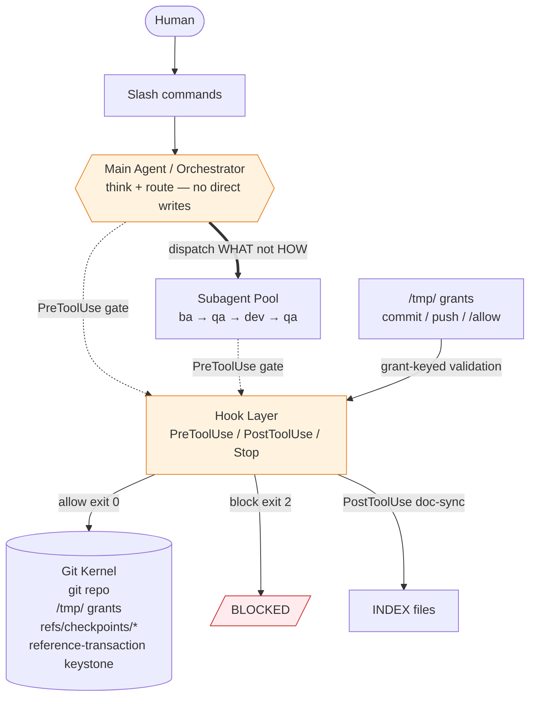

# How it works

The parts of the harness, how they fit together, and what each one is for.

[Back to the README](../README.md)

## Feature highlights

| Capability | What it gives you | Grounded in |
|---|---|---|
| **Orchestrator-only architecture** | The main agent routes; each real edit goes to a fresh subagent with one job and a clean context, so quality stays high. | `hooks/pretool-orchestrator-gate.py`, `CLAUDE.md` |
| **Durable specs** | `/spec` captures the requirement verbatim, persists design + evidence, and splits the monolith into per-agent briefing books with Gawande-style checkpoints. Feeds `/dev` as the authoritative source of truth. | `commands/spec.md`, `agents/spec.md` |
| **Evidence-gated BA → Dev → QA pipeline** | The analysis is QA'd *before* coding; every claim needs proof (git blame, grep, import-chain); the user's verbatim words are the binding spec. Pipeline: `/spec → /dev → /close → /commit → /push`. | `commands/dev.md`, `agents/ba.md`, `agents/qa.md` |
| **Release-readiness gate** | `/close` proves not just "the code works" but "the system can ship it" — Workflow-Integrity checks, optionally a multi-round QA↔Codex debate. | `commands/close.md` |
| **Git protection kernel** | The privilege guard exits 2 on an agent `commit / push / merge / reset --hard` unless a per-operation authorization grant is present (commit grant is single-use; push grant is wrapper-managed and retryable on failure); bash-safety exits 2 on wide-path checkout, stash-as-buffer, and hard-reset shapes by default. Each guard maps to a specific failure class it targets. | `hooks/pretool-git-privilege-guard.py`, `hooks/pretool-bash-safety.sh` |
| **Autonomous overnight pipeline** | `/dev-overnight 6:00` runs an unattended explore → triage → fix → verify loop until a wall-clock end time, committing nothing; you land the work once, afterwards. The Stop gate exits 2 while the overnight window is open; only a human-typed `/stop` releases it. | `commands/dev-overnight.md`, `hooks/stop-launch.py`, `hooks/stop-command-gate.py` |
| **Lossless quota recovery** | `/restart` resumes every recoverable interrupted child in the current parent transcript by its original `agent_id`; replacement agents are forbidden, and success requires response evidence from every candidate. | `commands/restart.md`, `hooks/lib/subagent_restart.py` |
| **Structured break-glass grants** | `/allow` writes a structured grant (`{op, target, args_contain}`) matched by command structure — consumed on any terminal result. | `hooks/lib/allowlist.py`, `commands/allow.md` |
| **Branch / PR / worktree firewall** | The hooks exit 2 on creating a branch, PR, or worktree by default everywhere, with explicit human escape hatches and a live-overnight exception. | `hooks/pretool-block-branch-pr-worktree.py`, `hooks/pretool-block-enterworktree.sh` |
| **Crash-proof checkpoints** | Snapshots written to `refs/checkpoints/<branch>` via git plumbing — never move `HEAD`, so `git blame` always points at a real semantic commit. | `hooks/lib/checkpoint-core.sh`, `docs/reference/checkpoint-mechanism.md` |
| **Self-updating documentation** | Edit a command or agent and `INDEX.md` / subdirectory `README.md` files (those with the `AUTO:readme-stats` annotation) and `CLAUDE.md` stat blocks regenerate automatically; root `README.md` has no annotation and is hand-maintained. | `hooks/posttool-doc-sync.py`, `hooks/doc_sync/` |
| **Adversarial second opinion** | Add `--codex` to `/dev`, `/close`, or `/commit` to run an OpenAI Codex round through a fail-closed isolation wrapper. | `commands/codex.md`, `commands/close.md` |
| **UI-audit skill suite** | Playwright-driven review: axe-core injection, APCA contrast, an anti-pattern catalog, state matrix, token conformance, and a weighted beauty score. | `skills/` |

## System architecture



## The full pipeline

```
   /spec                                  capture the requirement verbatim, split into per-agent briefs
     │
     ▼
   /do · /dev · /dev-command · /dev-overnight     do the work (direct, orchestrated, or autonomous)
     │
     ▼
   /close                                 release-readiness gate (QA, optionally a Codex debate)
     │
     ▼
   /commit                                surgical staging + conventional message + commit grant
     │
     ▼
   /merge · /push                         merge into the default branch · single-process gated push
```

Each stage hands a verified artifact to the next; `--codex` adds an opt-in adversarial round on `/dev`, `/close`, and `/commit`.

## Failure modes this exists to prevent

| Failure mode | Harness mechanism | Key file |
|---|---|---|
| Agent does too much in one context — quality silently degrades | Orchestrator-only gate; every real change goes to a single-purpose subagent with a clean context | `hooks/pretool-orchestrator-gate.py` |
| Irreversible git operation (history-erasing wide checkout; bulk unreviewed commit/push) | Git protection kernel: exit 2 on commit/push/merge/reset--hard without a grant; stash-as-buffer and wide-path checkout exit 2 by shape | `hooks/pretool-bash-safety.sh`, `hooks/pretool-git-privilege-guard.py` |
| Implementation drifts from the requirement | BA → QA-of-BA → Dev → QA pipeline; user's verbatim words written to disk as the binding spec before any code is written | `agents/ba.md`, `agents/qa.md`, `commands/dev.md` |

## Context-engineering guardrails

| Guardrail | What it exits 2 on | Why (context / safety) | Hook |
|---|---|---|---|
| Consecutive-Bash cap | 6th `Bash` in the main agent since the last `Agent` dispatch or prompt (limit 5; other tools between the calls do not reset the count) | Forces delegation before shell output floods the orchestrator's context | `pretool-orchestrator-gate.py` |
| Non-whitelist once-per-turn | 2nd `Edit`/`Write`/`WebFetch`/… of the same tool per turn in the main agent | Keeps real edits in clean subagent contexts, not the orchestrator's | `pretool-orchestrator-gate.py` |
| Read-size cap | Main-agent `Read` of a file >600 lines (unless sliced with `limit`≤600) | Stops one large file from swamping the lean context — delegate a summary instead | `pretool-read-size-guard.py` |
| Write-over-existing | `Write` onto a file that already exists (forces `Edit`) | Prevents silent whole-file loss from memory-reproduced content — no diff to catch it | `pretool-write-guard.sh` |
| No background dispatch | `Agent`/`Task` unless `run_in_background:false`; ordinary `SendMessage` and all `Workflow` calls | Background agents escape harness monitoring; only the supported `/restart` path (human-typed, or inside `/dev-overnight` the session's own wake while its span is open) may send the fixed recovery message to a transcript-discovered, pending interrupted ID | `pretool-block-background-tasks.py` |
| Gitignored-deliverable preflight | `Agent` dispatch when a dev-report names a gitignored file | Blocks a cycle that would pass QA yet never ship via git | `pretool-gitignore-preflight.py` |
| Todo sequence integrity | Illegal `TodoWrite` transitions (skip, multi-complete, reorder, content edit) | Keeps the plan an auditable one-step-at-a-time ledger | `pretool-todo-validate.py` |
| Privileged-git default-deny | `commit`/`push`/`merge`/`reset --hard` without a per-op grant | See [git protection kernel](git-protection-kernel.md#the-git-protection-kernel) | `pretool-git-privilege-guard.py` |

Each row states the condition under which the hook exits 2. [`ENFORCEMENT-LEDGER.md`](ENFORCEMENT-LEDGER.md) labels every one of these hooks `advisory` (source-level, or component-tested for the two git guards) and none host-observed: the table reports what the code does, not a refusal observed on a real host.

<p align="center">
  
</p>

<p align="center"><sub><em>Composed from real hook interceptions — every line traces to <a href="../.github/assets/hook-trace.json">.github/assets/hook-trace.json</a>. Stylized &amp; condensed, not a screen recording.</em></sub></p>

## The cast of subagents

The orchestrator dispatches specialists by *describing the problem* — never the tooling (`hooks/pretool-orchestrator-prompt-purity.py` watches for leaked "HOW"). Each picks its own approach and returns a structured report.

| Agent | Availability | Dispatch trigger | Key input | Key output |
|---|---|---|---|---|
| **`ba`** | always-on | Every `/dev` invocation | user requirement + git log | ticket-*.md + context-*.json |
| **`dev`** | after BA validated by QA | /dev Step 10 dispatch | context-*.json | implementation + dev-report-*.json |
| **`qa`** | always-on | BA spec or dev report delivered (/dev Step 7 and Step 13, and again on every retry) | BA spec or dev report | pass/fail + structured objections |
| **`test-writer`** | complexity ≥ STANDARD or risk_level = high | acceptance-criteria-*.json generated | acceptance-criteria-*.json | per-task manifest of pytest skeletons with TEST_INCOMPLETE hard-stops (Dev writes the test files) |
| **`graphify`** | CLAUDE_GRAPHIFY_ENABLED=auto and binary present | blast-radius-map.json generated | blast-radius-map.json | run record + focused subgraph under the dev-registry (Dev and QA dispatches name it); the context is read, never written |
| **`spec`** | /spec invocation | monolithic spec file provided | monolithic spec file | per-agent view files + Gawande-style checkpoints |
| **`architect`** | overnight + on-demand | /dev or /dev-command Step 3 when assessed RELEVANT; /dev-overnight Step 3 of an exploration cycle | requirement (/dev); test plan with the live app URL (overnight) | structured JSON report per specialist |
| **`product-owner`** | overnight + on-demand | /dev or /dev-command Step 3 when assessed RELEVANT; /dev-overnight Step 3 of an exploration cycle | requirement (/dev); test plan with the live app URL (overnight) | structured JSON report per specialist |
| **`user`** | overnight + on-demand | /dev or /dev-command Step 3 when assessed RELEVANT; /dev-overnight Step 3 of an exploration cycle | requirement (/dev); test plan with the live app URL (overnight) | structured JSON report per specialist |
| **`ui-specialist`** | overnight + on-demand | /dev or /dev-command Step 3 when a visual/UI issue is assessed RELEVANT; /dev-overnight Step 3 of an exploration cycle | requirement (/dev); test plan with the live app URL (overnight) | structured JSON report per specialist |
| **`pm`** | overnight | /dev-overnight invocation | live app URL + test plan | PLAN/TRIAGE/RETRO structured report |
| **`changelog-analyst`** | /commit invocation | /commit command | git diff + dev report | surgical staged commit + push-gate token |
| **`push-analyst`** | /push invocation | /push command | commits/branch range | nonce-keyed grant + risk summary |
| **`merge-analyst`** | /merge invocation | /merge command | commits/branch range | nonce-keyed grant + risk summary |
| **`pull-analyst`** | /pull invocation | /pull command | commits/branch range | risk summary |
| **`cleaner`** | /clean invocation | /clean command | approved cleanup actions from the inspector reports | hygiene execution report |
| **`cleanliness-inspector`** | /clean invocation | /clean command | project tree | hygiene audit report |
| **`style-inspector`** | /clean invocation | /clean command | project tree | style violations report |
| **`rule-inspector`** | /clean invocation | /clean command | project tree | discovered folder rules |
| **`prompt-inspector`** | /clean invocation | /clean command (Step 10A) | agent/command docs | verbosity violations report |
| **`git-edge-case-analyst`** | on-demand | on request | git history | edge case report |
| **`test-executor`** | /test invocation | /test command | test files | execution report |
| **`test-validator`** | /test invocation | /test command | test files | validation report |

> Full, auto-maintained roster: [`agents/README.md`](../agents/README.md).

Agents remove a tracked file with a non-forced `git rm` (with or without `-r`, `-n`, `-q` or `--`): git refuses a file that differs from HEAD or the index, so a removed file comes back with `git checkout <sha> -- <path>`. bash-safety allows it for literal paths outside the harness home that are not submodules, and exits 2 on a forced or wrapped `git rm`, on `rm` and `unlink`, and on a `git rm` that removes a file in the harness home.

## The command surface

| Group | Command | What it does | When to use |
|---|---|---|---|
| **Spec** | `/spec` | Capture the requirement verbatim, persist design + evidence, split into per-agent briefs + Gawande-style checkpoints. | Starting a net-new feature that needs a persisted design contract. |
| **Spec** | `/spec-update` | Update an existing spec, continue unfinished development, or write a temp session note. | `/dev`, `/redev` or a failed `/close` left unfinished work, or an existing spec needs enriching. |
| **Develop** | `/dev` | Orchestrated development pipeline: BA subagent delegation, parallel agent execution, iterative QA verification. | You have a requirement to build; several requirements fan out to parallel one-issue lanes in the same cycle. |
| **Develop** | `/dev-command` | Command-authoring dev pipeline. | The thing you're building is itself a command or agent. |
| **Develop** | `/dev-overnight` | Autonomous overnight loop. | A backlog to grind through unattended, all night. |
| **Develop** | `/redev` | `/dev` under a fresh task id on every invocation, without re-emitting its text (same arguments, steps, gates and artifacts). | The /dev workflow context is already present; new requirement text is optional. |
| **Ship** | `/close` | Release-readiness gate (QA verdict + optional Codex debate); it first completes an unfinished cycle and ends by asking you to rate it. | After dev finishes, to land the close verdict. Optional before `/commit <task-id>`, which closes an unclosed task itself. |
| **Ship** | `/commit` | Surgical staging + conventional commit message + commit grant. | When you're ready to record the change; an unfinished or unclosed cycle is completed and closed first. |
| **Ship** | `/merge` | Merge a commit-ish into the default branch, with the pre-merge analyst's grant. | After commit, to carry the change into the default branch. |
| **Ship** | `/push` | Single-process gated push with push analyst grant. | After commit/merge, to publish the branch to remote. |
| **Ship** | `/pull` | Safe `git pull` (stash management, conflict detection), then an advisory pull-analyst risk report. | You want to pull and get a read on what the incoming commits touch. |
| **Ship** | `/checkpoint` | Manual snapshot to `refs/checkpoints/<branch>`. | Want a safety snapshot without advancing HEAD or committing. |
| **Quality** | `/clean` | Cleanup cohort (cleaner + inspectors). | Repo has drifted — stray files or style violations to sweep. |
| **Quality** | `/test` | Test workflow (execute + validate). | You need the test suite executed and its results validated. |
| **Control** | `/do` | Break-glass consent for the main agent, one turn (never a subagent); does not silence the bulk-commit warning. | Main agent must break the rules for one entire turn. |
| **Control** | `/allow` | Structured single-use break-glass grant for one specific operation. | Green-light one specific blocked operation, a single time. |
| **Control** | `/restart` | Resume every quota-interrupted subagent from its original transcript and ID; with no recoverable subagent, continue the invoking session's own main agent. Optional trailing text is carried verbatim as guidance for the next phase. | A session/usage limit interrupted running subagents — or interrupted a session that had none, leaving only the main agent to continue. |
| **Control** | `/stop` | Cancel an overnight session. | Mid-overnight, to abort a running session. |
| **Control** | `/tickets` | Read-only lifecycle table: the state and next action of every ticket, spec and lane. | Before `/close` or `/commit`, to see where every task stands. |
| **Control** | `/rating` | Read-only terminal view of every agent's score, rank, trend and latest scored events for this project, then your latest ratings. | After a `/close`, or any time, to see how each agent is doing. |
| **Control** | `/harness` | `/harness off` switches the whole harness off for this home (no hook from that moment; no harness settings, CLAUDE.md, commands or agents from the next session); `/harness on` brings back exactly what was there; `/harness status` says which. Owner-typed only. | You want plain Claude Code for a while, with your MCP servers, plugins, login and history as they are. |
| **Control** | `/codex` | Delegate a task to OpenAI Codex for a second opinion or parallel coding. | You want an adversarial second opinion from an outside model. |
| **Control** | `/paseo-daemon` | Multi-session monitoring and three-account scheduling control plane. | Bootstrapping or advancing the persistent scheduling state machine. |

> Each command's own file: [`commands/`](../commands/).

## Pipeline in action

### Walkthrough 1 — `/dev "the login button is misaligned on mobile"`

| Step | Who acts | What happens | Bounds |
|---|---|---|---|
| 1 | UserPromptSubmit hook | Starts the cycle: mints its task id and creates its dev-registry directory (a role's sentinel file is created by `hooks/pretool-cp-checkin.py` when that role's dispatch first reads it); writes verbatim requirement to disk as the binding spec | — |
| 2 | Orchestrator | Evaluates specialist triggers (e.g., `ui-specialist` for layout reports); must justify RELEVANT-or-SKIP per specialist — silently skipping is itself a violation | — |
| 3 | BA subagent | Git root-cause analysis → finds the *actual* file (not a plausible cousin); emits Markdown ticket + JSON context, scored on the clarity dimensions (What/Why/Where/Scope/Success) | — |
| 4 | QA subagent | Validates the BA *before any code is written*: git-blame evidence? files exist? scope narrowed? investigation actually done? acceptance-criterion text matches what is run? If weak, BA is sent back | No round cap: a QA fail loops back to BA until QA passes (pass is the only exit) |
| 5 | Dev subagent | Implements the vetted plan under minimum-diff discipline; runs self-verification (build + smoke) | — |
| 6 | QA subagent | Verifies against acceptance criteria; on failure records each failure with a `primary_cause` (`ba_spec` / `dev_implementation` / `qa_oversight` / `environment`) | No attempt cap: a QA warning or fail re-dispatches the lane's dev until QA passes; a third attempt at a layer that failed twice draws a warning from `pretool-layer-escalation-check.sh` (it exits 0) |
| 7 | `/close → /commit → /push` | Release-readiness gate, then grant-gated git pipeline | — |

## Usage examples

```bash
# Orchestrated development (vague requirements welcome)
/dev add a --dry-run flag to the export command

# Adversarial review enabled
/dev --codex fix the off-by-one in pagination

# Autonomous overnight run until 6am, focused on a subsystem
/dev-overnight 6:00 fix flaky tests in the parser

# Cancel an overnight session
/stop
```

## Project structure

```text
.claude/
├── CLAUDE.md          # The constitution: non-negotiable rules the agent must obey
├── ARCHITECTURE.md    # Deep technical architecture and design rationale for maintainers
├── settings.json      # clean form: hook wiring and permissions (paseo module off)
├── settings.machine.example.json  # documented example of the untracked machine overlay
├── agents/            # subagent definitions (BA, dev, QA, architect, …)
├── commands/          # slash-command workflows (/spec, /dev, /close, /commit, …)
├── hooks/             # SessionStart / UserPromptSubmit / PreToolUse / PostToolUse / Notification / Stop / SubagentStop gates
│   ├── lib/           #   shared libs: allowlist (structured sentinel grants), checkpoint-core
│   ├── doc_sync/      #   self-updating INDEX/README/CLAUDE regeneration
│   └── git-keystone/  #   git-native reference-transaction protection
├── scripts/           # helper scripts (graphify, spec resolver, grant writers, execute-push, …)
├── skills/            # the Playwright UI-audit suite (+ ui-shared support)
├── schemas/           # JSON schemas (e.g. cycle-contract.v1.json)
├── policies/          # tool-policy and role-restriction definitions
├── templates/         # spec templates (spec-template.md, overnight-spec.md)
├── tests/             # test infra; a cycle's AC-driven pytest skeletons are written to tests/generated/ (gitignored, created at run time)
└── docs/              # these pages, the enforcement ledger, threat model and adversarial corpus, and reference/ (mechanisms, incidents, rulings, plans)
```

**Root-level files:**

| File | Purpose |
|---|---|
| `LICENSE` | MIT license text |
| `NOTICE` | Attribution notices |
| `push.sh` | Global pre-push checks: git identity + fetch/pull/status |
| `requirements.txt` | Python dependency manifest for the harness venv |
| `settings.json` | Claude Code harness configuration (permissions, hooks, env) — the one tracked settings source, in clean public form; the working copy is rendered with the machine overlay |
| `settings.machine.example.json` | Documented example of the untracked machine overlay `settings.machine.json` (every key, the paseo module, the private-literal list) |
| `.gitattributes` | Declares the `claude-settings` clean/smudge filter for `settings.json` (registered locally by init) |

**Core vs. optional:**

- **Git mutation kernel minimum** (security guardrails engage): `settings.json` + `hooks/` + `scripts/bootstrap` + `hooks/lib/`. Without these, hooks fail at import time and the kernel is inactive.
- **Full subagent + tool-policy security** (all role-based deny rules active): everything above **plus** `policies/`. Without `policies/`, the pretool-tool-policy gate fail-opens for the `dev` role; other roles fail-closed.

Everything else (`agents/`, `commands/`, `skills/`, `schemas/`, `templates/`, `tests/`) is an advisor or convenience — the security kernel continues to operate without any of these, though the `/dev` pipeline is degraded without `agents/` and the grant-gated release path needs `scripts/`.

#### Hook events

Counted from the tracked clean `settings.json`, paseo module off (with it on, `UserPromptSubmit` has one more).

| Event | Hook entries | Primary purpose |
|---|---|---|
| SessionStart | 8 | Session info banner, scratch-directory init, runtime-directory gitignore propagation, todo/command drift check, hook canary, tmpfs banner (plus opt-in git init and RAM-disk promotion) |
| UserPromptSubmit | 6 | Command start (checklist injection, cycle ids, verbatim requirement to disk), `/allow` grant, `/restart` and `/commit --bulk` capability minting, doc-sync deletion check, tmpfs pressure warning |
| PreToolUse | 35 | The gate layer: orchestrator rate-limit, bash-safety, git kernel, tool-policy, branch/PR firewall |
| PostToolUse | 17 | Doc-sync, allowlist grant consumption, checkpoint writes |
| PostToolUseFailure | 1 | Allowlist grant consumption on a failed tool result |
| Notification | 1 | An exit-0 stub (`notification-idle-overnight.py`): reads and writes nothing |
| Stop | 1 | One entry, `stop-launch.py`, which runs the workflow coordinator: its phases are the spec-coverage phase (an exit-0 stub: the split is decided at the spec subagent's own stop), the auto-commit checkpoint snapshot, the completion gate (overnight time-lock, `/do` report, the other gated commands) and allowlist cleanup |
| SessionEnd | 1 | Scratch-directory sweep |
| SubagentStop | 8 | cp-state enforcement, artifact contract, e2e and codex-ledger checks, `/restart` response evidence, minimum-diff, layer-match and guard-integrity warnings |

Retired hooks stay in the tree as exit-0 stubs (marked by a `# STUB:` line), so a running session whose loaded hook list still names one gets exit 0, never a missing file. Three are still registered in `settings.json` and count in the table above: `notification-idle-overnight.py`, `posttool-push-gate-token-verify.py` and `pretool-push-analyst-grant-guard.py`. `render-settings check` (run by `scripts/doctor`) fails a hook command whose file is missing or is a stub the clean form does not register. The landing repairs an overlay that registers one: at the first Stop after HEAD moves, it drops from `settings.machine.json`, and from the working `settings.json`, each hook command whose script is a harness hook HEAD deleted or marks `# STUB:`, or that another registered command already runs, and `logs/landing.log` names the drops by event and count.

## Design philosophy

| Principle | Binding rule | Enforced by |
|---|---|---|
| Rules, not stories | Every infrastructure-touching subagent prompt carries an explicit DO NOT section; positive instructions alone proved insufficient | agents/ba.md, agents/dev.md, CLAUDE.md §11 |
| Enforce in code, not prose | PreToolUse hooks return exit 2; /do (one turn, main agent only) and /allow (single-use) are narrow, audited grants | hooks/pretool-git-privilege-guard.py, hooks/pretool-bash-safety.sh |
| Orchestrator describes WHAT; subagent decides HOW | Dispatch prompts never name a tool or shell command (the prompt-purity hook warns on a HOW prescription and exits 0; it never blocks) | hooks/pretool-orchestrator-prompt-purity.py |
| One subagent, one task | N issues → N parallel subagents; bundling inside one subagent is banned | CLAUDE.md §13 |
| User's verbatim words are the contract | Literal requirement written to disk at UserPromptSubmit; re-read by every downstream agent | UserPromptSubmit hooks, agents/ba.md |
| Fail closed, leave forensics | Ambiguous grant → reject; unparseable verdict → treat as failure; evidence (grant file, raw output) left on disk | hooks/pretool-git-privilege-guard.py, hooks/pretool-bash-safety.sh (not every gate hook: the orchestrator gate and the background-task block fail open on a malformed payload) |
