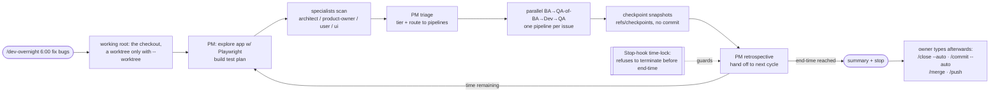

# The overnight pipeline

How `/dev-overnight` runs unattended until a wall-clock end time.

[Back to the README](../README.md)

## The overnight autonomous pipeline

`/dev-overnight` runs a todo-completion-driven loop in your current checkout by default (this needs bubblewrap: without it the launch is refused and writes no state), or in an isolated worktree with `--worktree`. The Stop gate (`hooks/stop-command-gate.py`, its time-lock step) refuses to end the conversation until your wall-clock end time; with no end time the window is 8 hours from the start (`scripts/create-overnight-state.sh`). After that time the session ends once its closeout is on disk, a PM retrospective report under `docs/dev/overnight/<session>/` and an overnight summary under `docs/dev/` written since the session started, and the session's scheduled wake has been deleted. Each issue gets its own one-issue-per-subagent pipeline; cycles deduplicate against state. Nothing is committed per cycle: the work stays in `refs/checkpoints/<branch>`, and after the session you land it once by typing `/close --auto`, `/commit --auto`, `/merge <worktree_branch>` (`--worktree` sessions only) and `/push`; the session runs none of them. Cancel any time with `/stop`: a typed `/stop` releases the window at once, with no closeout check; the gate still holds the Stop until the session's scheduled wake is deleted with `CronDelete`.

> **Limitation.** By default the overnight session works in your checkout itself, with no worktree boundary; with `--worktree` it runs in a *linked* worktree that shares the repository `.git` common-dir with the main checkout — an accepted deviation, not a clean isolation guarantee, documented in `commands/dev-overnight.md`.
