# Status

What is proven about this harness and what is not, on one page. Every figure on it is generated from the repository: `scripts/generate-hero-status.py` writes the regions below and takes every count from `scripts/readme_facts.py`, and `scripts/verify-claims.sh` re-derives each region in CI and fails when one has drifted or a number is typed by hand. The front page is the [README](../README.md).

## Measured proof

Counted from the repository by `scripts/readme_facts.py` and re-derived by `scripts/verify-claims.sh`. A result (no gate block, no hook error, no violation) is not copied here: the test or check named in the last column fails CI when it does not hold.

<!-- BEGIN canonical-region id=proof — generated by scripts/generate-hero-status.py; do not hand-edit -->
| Counted from the repository | Now | CI fails when |
|---|---|---|
| Python versions CI runs the baseline job on | 3.10, 3.11, 3.12 | a step of the baseline job fails on any of them (`.github/workflows/baseline.yml`) |
| Pipelines replayed | 10 pipelines, 15 compliant scenarios, 2 settings modes (shipped, armed), 30 compliant replays | a compliant replay that meets a gate block or a hook error, or does not reach its terminal, fails CI (`tests/replay/test_pipelines.py`) |
| Faults injected | 9 fault classes in 25 variants; 4 regression replays (R-E1, R-N1, R-P1, R-V1) | a fault that no gate returns to its producer, or that its producer does not repair without human action, fails CI for 8 of the 25 variants (`tests/replay/test_faults.py`); the regression replays are in `tests/replay/test_regressions.py` |
| Blocking sites of the registered hooks | 187 sites: 33 own-obligation gates, 129 denials of a forbidden operation, 4 time-lock; 21 with no clearing class | a replay that reaches a blocking site with no clearing class fails CI (`tests/replay/test_no_dead_end.py`) |
| file artifacts declared by the producers' obligation templates in commands/*.md, read statically; not the artifact total the CI job "artifact check (traced replays)" reports | 28 (distinct path patterns, from 55 declarations in 44 obligation templates) | an artifact without one producer or without a deciding reader fails the check, which keeps no exception list (`tests/test_artifact_graph.py`) |
| Tests, counted statically (parametrization not expanded) | 5,652 test functions in 317 files: `hooks/tests` 3,057 in 170 files, `tests` 2,595 in 147 files | the unit suite fails on any of 3.10, 3.11, 3.12 (it leaves out `tests/artifact_graph/test_mutations.py`, `tests/generated`, `tests/replay`, `tests/test_artifact_graph.py`) |
| Hook registrations in the tracked `settings.json` | 54 entries in 9 events (PreToolUse 20, PostToolUse 14, SessionStart 8, UserPromptSubmit 6, PostToolUseFailure 2, SessionEnd 1, Stop 1, SubagentStart 1, SubagentStop 1) | ledger rows that differ from the registered hooks fail `scripts/check-enforcement-evidence.py` |
<!-- END canonical-region id=proof -->

## Hero recording

  

<em>An <strong>animated SVG replay generated from a captured log</strong> — every <em>terminal</em> line is a byte-exact slice of <a href="../.github/assets/hero-capture.txt"><code>.github/assets/hero-capture.txt</code></a>, reproducible with <code>python3 scripts/capture-hero-run.py --check-only</code>. The demo deliberately pauses between beats so a person can read each refusal, and those waits really happened. The animation's own cadence is the renderer's, not the recording's. The hook decisions are real; the tool dispatch is a synthesized fixture. <strong><a href="../.github/assets/hero-capture.txt">Read the raw capture</a></strong> for the full, untruncated text.</em>

## Status and known limits

Generated claim rows. `scripts/generate-hero-status.py --check`, run by `scripts/verify-claims.sh`, re-derives each row and fails when one is stale; a row reads `passed`, `partial` or `not-yet`.

<!-- BEGIN canonical-region id=limits — generated by scripts/generate-hero-status.py; do not hand-edit -->
<!-- claim-row id=known-limits state=not-yet evidence=hooks/tests/fixtures/adversarial_corpus.json tracked=spec-item-D -->
**Known limits** — probe corpus present and the permission layer now carries git-related deny rules; re-running the corpus at build time is not yet wired, so this control stays unverified rather than claiming a pass.
<!-- END canonical-region id=limits -->

<!-- BEGIN canonical-region id=disclosure — generated by scripts/generate-hero-status.py; do not hand-edit -->
<!-- claim-row id=hero-recording state=passed evidence=.github/assets/hero-capture-evidence.json tracked=none -->
**Hero recording** — the recorded session ran **11.972 s**; the replay loops every **31.25 s** (2.61x the recording), and the grant-consumed proof line first appears **18.1 s** in — 57.9 % through the loop, not at landing.
<!-- claim-row id=hero-legibility state=partial evidence=.github/assets/guard-hero.svg tracked=hero-glyph-floor -->
**Hero legibility** — nothing is cut off: every replayed line fits inside the 1430 px panel. But fitting them took a panel that wide, and the page scales it down to fit the column, so the inline text lands below the 11 px readability floor at every measured viewport. Un-truncated is not the same as readable, so this is reported as partial, with the measured sizes below.
<!-- claim-row id=hero-glyph state=partial evidence=scripts/measure-hero-fold.py tracked=hero-glyph-floor -->
**Hero inline size** — the replay's text renders at **7.55 px** at a 1280 px viewport and **3.76 px** at a 390 px viewport, against the **11 px** readability floor it misses at every measured viewport. Below that floor the transcript is on the page but too small to read there — on a phone it is roughly a third of readable size. Nothing is cut off; it is scaled down. Read it at full size in the linked capture.
<!-- END canonical-region id=disclosure -->

<!-- BEGIN canonical-region id=status — generated by scripts/generate-hero-status.py; do not hand-edit -->
<!-- claim-row id=supported-builds state=passed evidence=docs/reference/install-compatibility-matrix.md tracked=none -->
- **Supported builds** — declared and committed.
<!-- claim-row id=capability-check state=passed evidence=scripts/capability-handshake.py tracked=none -->
- **Strict capability check** — handshake committed and `scripts/doctor --strict` available (not executed here).
<!-- claim-row id=blackbox-tests state=not-yet evidence=none tracked=spec-item-D -->
- **Black-box guard tests** — not yet: none committed (spec item D).
<!-- claim-row id=release state=not-yet evidence=none tracked=spec-item-B -->
- **Release** — unreleased (no tags).
<!-- claim-row id=os state=partial evidence=.github/workflows tracked=none -->
- **OS** — Ubuntu (CI) only; macOS unverified.
<!-- claim-row id=enforcement-strength state=partial evidence=docs/ENFORCEMENT-LEDGER.md tracked=none -->
- **Enforcement strength** — the ledger has **54** rows, one per registered hook. Behavior labels: **0** enforced, **25** detected, **29** advisory, **0** unsupported. Proof layers: **0** host-observed, **0** host-shaped, **4** component-tested, **50** source-level, **0** none. No row is host-observed. A script that exits 2 is evidence about the script, not about a Claude Code host honouring it.
<!-- claim-row id=dead-end-sites state=partial evidence=tests/replay/test_no_dead_end.py tracked=none -->
- **Blocking sites with no clearing class** — **21 of 187** blocking sites of the registered hooks have no clearing class. The enumerator's reasons: **20** × fail-closed: the hook reports that it could not decide (a broken install or configuration); **1** × a PreToolUse refusal whose message names no operation. The suite fails only when a replay reaches one, so this is a known limit and not a proof that there are none.
<!-- END canonical-region id=status -->

Known limits in words, beyond the rows above:

- The end-to-end gate reads only the status a QA report records; it cannot see whether a page was rendered.
- The evidence fields of the analysis are schema-checked only for standard and complex tasks; small tasks skip them.
- Nothing judges whether a question to you is a real decision; that rule is prompt text, not a hook.
- QA and dev rounds have no cap: pass is the only exit, so a stubborn failure loops until you interrupt it.
- `/dev-overnight` works in your checkout by default, with no worktree boundary; with `--worktree` it shares the repository's git directory.
- Two prompts, `commands/close.md` and `commands/redev.md`, still name `~/.claude` literally, so a clone elsewhere needs them edited ([portability](installation.md#portability)).
- The replays and the demo feed hooks synthetic tool calls and read their exit codes; no live Claude Code session was driven.
